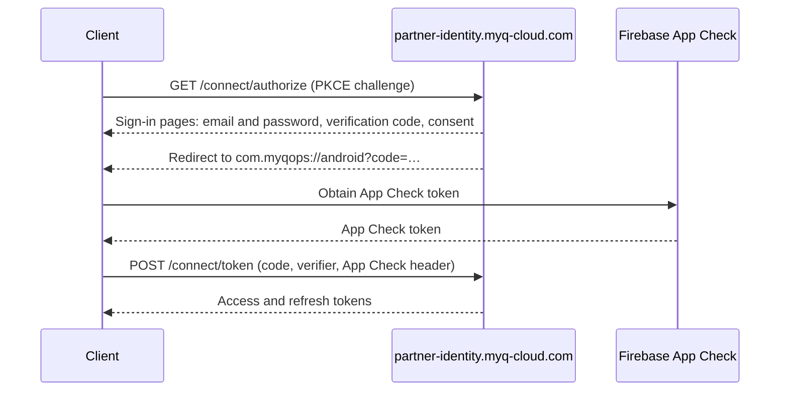
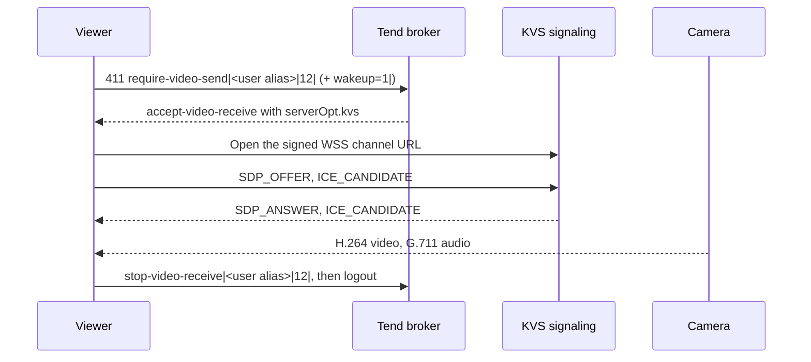

# MyQ API reference

This page describes MyQ's private cloud API as the MyQ Android app
(5.324.0.1132442, package `com.chamberlain.android.liftmaster.myq`) uses it,
and as this integration implements it. It is not an official specification, and
MyQ can change it at any time.

- [Services and hosts](#services-and-hosts)
- [Request conventions](#request-conventions)
- [Authentication](#authentication)
- [Accounts and roles](#accounts-and-roles)
- [Devices](#devices)
- [Commands](#commands)
- [Opener settings](#opener-settings)
- [Lock settings and PINs](#lock-settings-and-pins)
- [Account management](#account-management)
- [Cameras](#cameras)
- [Camera signaling (Tend)](#camera-signaling-tend)
- [Live video](#live-video)
- [Recordings](#recordings)

## Services and hosts

MyQ is a set of separate services, each on its own host. A route belongs to
one service; the same path on another host does not work.

| Service | Host | Used for |
| --- | --- | --- |
| Identity | `partner-identity.myq-cloud.com` | Sign-in pages, tokens, revocation |
| Profiles | `profiles.myq-cloud.com` | The signed-in profile |
| Accounts | `accounts.myq-cloud.com` | Accounts and account roles |
| Devices | `devices.myq-cloud.com` | Device list, renaming other devices |
| Device actions | `devices-action.myq-cloud.com` | Doors, gates, Wi-Fi locks, thermostats, Wi-Fi lock settings |
| Openers | `account-devices-gdo.myq-cloud.com` | Opener settings, lock mode, accessories, renaming openers |
| Lamps | `account-devices-lamp.myq-cloud.com` | Lamp on/off, renaming lamps |
| Locks | `devices-locks.myq-cloud.com` | Gateway locks, auto relock, lock PINs |
| Gateways | `gateways.myq-cloud.com` | Renaming gateways and hubs |
| Credentials | `residential-credentials.myq-cloud.com` | Keypad PIN lockout reset |
| Partner devices | `myq-partner-devices.myq-cloud.com` | Thermostat presets and schedules |
| Guest access | `guestaccess.myq-cloud.com` | Guests and their device access |
| Alerts | `alerts.myq-cloud.com` | Notification rules and snooze |
| Workflows | `workflows.myq-cloud.com` | Camera feature schedules |
| Account history | `accounthistory.myq-cloud.com` | Device activity history |
| Camera REST (Tend) | `media.hubs.tend-us.tendplatform.com` | Camera details, settings, images, wake-up, recordings |
| Recorded media | `events-media.prod.video.myq.com` | Recording playlists and segments (also served from Tend hosts) |
| Camera signaling (Tend) | `server.seedonk.com`, TCP 5104 (TLS) | Live video, camera commands, camera status |
| Firebase App Check | `firebaseappcheck.googleapis.com` | App verification for sign-in |

The app declares many other services (push registration, provisioning,
invitations, scenes, subscriptions, commerce and more). The integration does
not use them.

## Request conventions

**Authentication.** Every service request carries
`Authorization: Bearer <access token>`.

**MyQ service headers.** Requests to the `*.myq-cloud.com` services also send
the app's metadata:

| Header | Value |
| --- | --- |
| `BrandId` | `1` |
| `App-Version` | `5.324.0.1132442` |
| `User-Agent` | `<device model>/Android <version>`, for example `sdk_gphone64_arm64/Android 17` |
| `Accept-Encoding` | `gzip` |

**Tend headers.** Camera REST requests send `AntiCSRF: AntiCSRF` and the
bearer token, without the MyQ metadata above.

**Versions and casing.** Each service has its own API version, and paths are
case-sensitive as written: the device list is `/api/v6.0/Accounts/{account}/Devices`,
door actions are `/api/v1.0/...`, Wi-Fi lock settings are `/api/v1/...`, alerts
are `/api/v6.1/...`. Use the routes exactly as given here.

**Responses.**

- An HTTP 2xx answer only acknowledges a request. Whether a door moved, a lock
  changed or a setting was applied shows in the device's reported state
  afterwards.
- A 401 whose body `code` is `401.102` or `401`, or that has no code, means the
  access token was refused: renew it and send the request once more. A 401 with
  any other code, or a second 401, fails that request.
- A 429 carries `Retry-After`; nothing should be sent to that service until it
  has passed.
- On the sign-in pages, a 429 HTML page with `cf-mitigated: challenge` is a
  Cloudflare browser check, not a rate limit. Only a real browser can pass it.

## Authentication

Sign-in is OAuth 2.0 with PKCE. The Android app opens the authorization URL in
a Chrome Custom Tab, where the user signs in on MyQ's hosted pages. The pages
end by redirecting to the app's redirect URI with an authorization code, which
the app receives through its `com.myqops://android` intent filter. The app
exchanges that code for tokens, attaching a Firebase App Check token that
proves the request comes from the genuine app.

The integration completes the hosted pages in one of two ways. Automatic
sign-in submits their forms itself, which the app does not do.
[Browser sign-in](sign-in.md#browser-sign-in) has the user complete them in a
browser, as the app does, and paste the redirect address.



### Authorization request

`GET https://partner-identity.myq-cloud.com/connect/authorize` with:

| Parameter | Value |
| --- | --- |
| `client_id` | `ANDROID_CGI_MYQ` |
| `scope` | `MyQ_Residential offline_access` |
| `response_type` | `code` |
| `redirect_uri` | `com.myqops://android` |
| `code_challenge_method` | `S256` |
| `code_challenge` | Base64url SHA-256 of the code verifier, without padding |
| `ui_locales` | Language and country, such as `en-US` |
| `acr_values` | `unified_flow:v1  brand:myq` (two spaces) |
| `prompt` | `login` |

The app builds `acr_values` as flow, sign-up flag and brand separated by
spaces. The sign-up flag is empty when signing in, which leaves the two spaces.
Unlike the iOS app, the Android app sends no app version there.

The app sends no `state`, and accepts any redirect with its scheme and host and
a `code`. The integration adds a `state` and checks the redirect's scheme, path,
`state`, issuer when present, and single `code`.

### Hosted sign-in pages

The pages are ordinary HTML forms on the identity host. Each form carries
hidden fields, including `__RequestVerificationToken`, that must be sent back
with it, together with the cookies set during the sign-in.

Cloudflare protects the identity host and may answer with a browser check
instead of a page (see [request conventions](#request-conventions)). The
integration requests these pages with Chrome's TLS and HTTP/2 profile, matching
the Chrome identity in its headers.

The app also contains an older flow that fills these forms in a hidden WebView,
with `acr_values` set to `  brand:myq` (no flow version). Its login screen does
not start that flow: it supplies no email or password, so the app renews the
saved session instead. New sign-ins use the Custom Tab.

| Step | Request | Fields |
| --- | --- | --- |
| Email and password | `POST /Account/LoginWithEmail?returnUrl=…` | `Email`, `Password`, `ReturnUrl`, hidden fields |
| SSO check (website script) | `POST /api/v1.0/externalaccounts/IsSSOEnabledForDomain` | JSON `{"email": …}`; answers `true` or `false` |
| Verification code | `POST /AccountMfa/VerifyOtp?returnUrl=…` | `Otp`, plus hidden `SelectedMfaMethod`, `IsSmsMethodEnabled`, `MaskedEmail`, `MaskedPhoneNumber`, `__Invariant` |
| Choose email instead of SMS | Same page | `selectedMfaMethod=Email` |
| Consent | `POST /Consent` | The form's fields with `button=yes` |
| Return to the app | `/connect/authorize/callback` | Redirects to `com.myqops://android?code=…` |

### App Check token

The code exchange carries a Firebase App Check token in the
`Firebase-AppCheck-Token` header. Without an accepted token, MyQ refuses the
exchange with code `401.122`. The app uses an ordinary App Check token, not a
limited-use one, and reuses it until it expires.

The Android app obtains the token from Google Play Integrity through Firebase's
`generatePlayIntegrityChallenge` and `exchangePlayIntegrityToken` calls. The
integration uses a registered App Check debug token instead:

```text
POST https://firebaseappcheck.googleapis.com/v1/projects/{project}/apps/{app}:exchangeDebugToken?key={api key}
X-Android-Package: com.chamberlain.android.liftmaster.myq
X-Android-Cert: <signing certificate SHA-1, hexadecimal>
Content-Type: application/json

{"debugToken": "<registered debug token>"}
```

The answer is `{"token": "<App Check JWT>", "ttl": "3600s"}`. Firebase answers
401 or 403 when the debug token is not registered for that app. A token with
five minutes or less left should not be used. The App Check token is needed for
the code exchange only, not for renewal or any other request.

### Code exchange

```text
POST https://partner-identity.myq-cloud.com/connect/token
Content-Type: application/x-www-form-urlencoded
Firebase-AppCheck-Token: <App Check token>

client_id=ANDROID_CGI_MYQ
scope=MyQ_Residential offline_access
grant_type=authorization_code
code=<authorization code>
redirect_uri=com.myqops://android
code_verifier=<code verifier>
```

There is no client secret. The form is encoded as OkHttp encodes it: spaces
become `+`, `+` becomes `%2B`, `~` becomes `%7E`, and `*` stays as it is.

The answer has `access_token`, `refresh_token`, `expires_in` and `token_type`.
An authorization code can be exchanged once; a failed exchange needs a new
sign-in.

### Renewal

```text
POST https://partner-identity.myq-cloud.com/connect/token
IsRefresh: true
Authorization: Bearer <current, possibly expired, access token>

client_id=ANDROID_CGI_MYQ
grant_type=refresh_token
refresh_token=<refresh token>
```

The app renews before a request once the access token is past its effective
lifetime:

```text
max(floor(0.95 × expires_in), expires_in − 300) seconds
```

`expires_in` defaults to 3,600 seconds when the answer omits it. When the answer
omits `refresh_token`, the current one stays valid. Concurrent requests share one
renewal.

### When a session ends

| Token endpoint answer to a renewal | Meaning |
| --- | --- |
| `error=invalid_grant`, or `code` `401.102` or `400` | The session has ended; the user must sign in again |
| Any other failure (other 4xx, 5xx, network error, empty body) | The session continues; try again later |

The app signs out only in the first case, and not if another request rotated
the refresh token meanwhile.

### Revocation

```text
POST https://partner-identity.myq-cloud.com/connect/revocation
Authorization: Bearer <access token>

client_id=ANDROID_CGI_MYQ
token_type_hint=refresh_token
token=<refresh token>
```

This ends that one session. Other sign-ins, such as the phone app, stay signed
in.

## Accounts and roles

| Request | Answer |
| --- | --- |
| `GET profiles /api/v6.0/my/profile` | The profile: `user_id`, `email` |
| `GET accounts /api/v6.0/accounts` | `accounts`: each with `id`, `name`, `created_by` |
| `GET accounts /api/v6.0/accountAccess` | The user's role in each account |

A profile can see several accounts: its own and those shared with it. The
account-access answer looks like this:

```json
{
  "account_access": [{
    "account_id": "…",
    "role": "owner",
    "permissions": {"devices": ["View", "Control", "Manage", "Delete"], "guests": ["All"]}
  }]
}
```

Roles are `owner`, `co_owner`, `family`, `guest`, `guest_nomyquser` and
`quick_pass`, compared without regard to case. The app parses the permission
lists but never reads them: every screen is gated on the role. The user owns an
account when its `created_by` is their `user_id`, even if account access cannot
be read.

| Operation | Roles the app allows |
| --- | --- |
| Live view, camera controls, recordings, alert rules | Every role |
| Alert snooze | Owner, co-owner |
| Device history, guest list, gateway lock PINs | Every role except guest |
| Wi-Fi lock auto lock and door sensor, keypad lockout reset | Owner, co-owner |
| Opener settings, lock mode, renaming, accessories, auto relock, camera settings and schedules, guest changes | Owner |

### Feature flags

`GET profiles /api/v6.0/my/features` lists the features MyQ has enabled for the
user: `{"features": [{"feature_id": "<flag>"}, …]}`. Three change how live
video starts:

| Flag | Effect |
| --- | --- |
| `enable_vmw_wakeup` | Tend's video service wakes a sleeping camera, through the video request's `wakeup` field, instead of the wake-up request (see [Live video](#live-video)) |
| `enable_connection_mode_override` | Video modes MyQ lists as failing for a camera are skipped (see [Mode 9](#mode-9-tc-cameras)) |
| `enable_new_live_stream_connection_flow` | Changes the app's mode order for some cameras; the integration does not act on it |

The integration reads the list when live video starts, at most once an hour (a
failed read is retried after five minutes, keeping the flags read before).

## Devices

### Device list

`GET devices /api/v6.0/Accounts/{account}/Devices` returns `items`, `count` and
`href` for one account. There is no paging. Each item has:

| Field | Meaning |
| --- | --- |
| `serial_number` | The device's identifier within the account |
| `name`, `device_model` | Display name and model (the model may also be in `state.model_number`) |
| `device_type`, `device_family` | Which kind of device it is, and so which commands apply |
| `device_platform` | `seam` for partner locks |
| `capabilities` | Capability names |
| `state` | Connectivity, door/lock/lamp state, diagnostics, permissions and associations |
| `specifications` | Thermostat modes and setpoint limits |
| `parent_device_id` | Serial of the parent device, such as the Wi-Fi gateway built into an opener |
| `gateway_id` | Serial of the gateway (older records use `state.gatewayID`) |

A serial number identifies a device only within its account.

### Device types

| Kind | `device_type` |
| --- | --- |
| Garage door openers | `garagedooropener`, `wifigaragedooropener` |
| Virtual (learned) doors | `virtualgaragedooropener` |
| Gates and commercial doors | `gate`, `commercialdooropener` |
| Lamps | `lamp` |
| Wi-Fi locks | `wifilockgateway` (a lock, despite the name), and locks with `device_platform` `seam` |
| Gateway-connected locks | `lockitron` and other types ending `_lock` |
| Thermostats | Types ending `_thermostat`, family `hvacs` |
| Gateways and hubs | `ethernetgateway`, `hub`, `smarthub`, `homebridge`, `wifigdogateway`, `wifirjo`, `vkpgateway`, `wifichimegateway`, `wifidashworklightgateway` |
| Cameras | Family `camera` or `tend`, or types such as `tendcamera`, `indoor-camera`, `outdoor-camera`, `outdoor-bat-camera`, `doorbell-camera`, `smartptzcam1`, `smartflcam1`, `smartlockcam`, `videokeypadcocam`, `SmartGarageLCCam2`, `SmartIndoorLCCam2` |

A camera built into an opener or a lock is a separate device record of its own.
`smartlock` is not a camera.

### Reported state

| Field | Values |
| --- | --- |
| `online` | Missing means online. A `wifilockgateway` reports through `camera_online` when present |
| `door_state` | `open`, `closed`, `opening`, `closing`, `stopped`; case varies |
| `lock_state` | `locked`, `unlocked`, `locking`, `unlocking`; case varies |
| `lamp_state` | `on`, `off` |
| `monitor_only_mode` | Missing means false, except for `virtualgaragedooropener`, where it means true |
| `is_unattended_open_allowed`, `is_unattended_close_allowed` | Missing means allowed |
| `failed_credential_lockout_active` | Keypad locked out after wrong PINs |
| `attached_work_light_error_present` | The opener's work light is not paired |
| `sensor_comm_error`, `number_of_learned_dps_devices` | A virtual door's sensor fault |
| `bluetooth_connectability` | Gateway locks: `remote` or `busy` can be reached through the gateway; `local` is Bluetooth only |
| `in_vacation_mode` | Opener lock mode (remotes disabled) |

## Commands

### Doors and gates

```text
PUT https://devices-action.myq-cloud.com/api/v1.0/accounts/{account}/devices/{serial}

{"action": "open", "trigger": "myq_an", "device_family": "garagedoor"}
```

`close` is the only other action; there is no stop or position command. The
app refuses a command when the door is offline, monitor-only, locked out after
wrong PINs, reports an unpaired work light, or (for a virtual door) reports a
sensor fault. Closing needs `is_unattended_close_allowed`; the integration
applies the same rule to opening with `is_unattended_open_allowed`. Missing
flags mean allowed.

### Lamps

```text
PUT https://account-devices-lamp.myq-cloud.com/api/v6.0/accounts/{account}/lamps/{serial}/on
PUT https://account-devices-lamp.myq-cloud.com/api/v6.0/accounts/{account}/lamps/{serial}/off
```

No body. There is no brightness or colour. These routes do not control an
opener's work light.

### Locks

| Lock | Request |
| --- | --- |
| `wifilockgateway` and `seam` locks | `PUT devices-action /api/v1.0/accounts/{account}/devices/{serial}` with `{"action": "lock"}` or `{"action": "unlock"}` |
| Gateway-connected locks | `POST devices-locks /api/v6.0/accounts/{account}/devices/locks/{serial}/lock?requestRemote=true` (or `/unlock`), no body |

A lock command needs a settled `locked` or `unlocked` state, no monitor-only
mode, no keypad lockout, no work-light error, and
`is_unattended_close_allowed` (missing means allowed). A gateway lock also needs
a gateway and a `bluetooth_connectability` of `remote` or `busy`. A lock with
neither route is Bluetooth only and cannot be controlled through the cloud.

### Thermostats

A thermostat change is one action on the device action route:

```json
{"action": "heat_cool", "device_family": "hvacs", "temperature_unit": "celsius",
 "heating_set_point": 20.0, "cooling_set_point": 25.0, "fan_mode": "auto"}
```

- `action` is `off`, `heat`, `cool` or `heat_cool`. `heat` sends only the
  heating point, `cool` only the cooling point, `off` neither.
- `temperature_unit` is the thermostat's own unit (Fahrenheit when not
  reported). Targets are rounded half up to whole °F or tenths of a °C.
- Heating and cooling targets stay at least 3 °C or 5 °F apart. With no reported
  targets the app starts from 68/78 °F or 20/26 °C.
- The fan is changed by resending the current mode with a new `fan_mode`. A
  separate `set_fan_mode` action exists but the app does not use it.
- Limits come from `specifications` (`min_*` and `max_*` per mode and unit).
  `temperature_threshold` is an alert band, not a limit.
- A thermostat is controllable only while `is_managed` is true (missing means
  true).

### After a command

An acknowledged command has not necessarily finished. The app follows a device
by re-reading the account's device list until it reports its target state:

| Device | Re-read interval | Gives up after |
| --- | --- | --- |
| Openers, lamps and other devices | 2 seconds (doors), 1 second (others) | 60 seconds |
| Virtual doors | 2 seconds | 90 seconds |
| Gates and commercial doors | 2 seconds | 120 seconds |
| Locks | 1 second | 30 seconds |

A device that reports `opening`, `closing`, `locking` or `unlocking` is followed
the same way. After a thermostat change the app re-reads the device two seconds
later.

A command whose outcome is unknown, such as one that timed out, must not be sent
again: MyQ may already have acted on it.

## Opener settings

Owner only. All on
`https://account-devices-gdo.myq-cloud.com/api/v6.0/accounts/{account}/door_openers/{serial}/`.
`GET` reads the setting and `PUT` changes it.

| Suffix | Body | Values |
| --- | --- | --- |
| `lighttimer` | `{"light_timer_setting": 150}` | 90, 150, 210 or 270 seconds |
| `timetoclose` | `{"time_to_close_setting": 300}` | Seconds; 0 is off, the app offers 1–99 minutes |
| `worklight_settings` | `{"enable_pir_control": true, "enable_motion_wl": true}` | One switch in the app; both are written together |
| `lockmode` (`PUT` only) | `{"enable_lock_mode": true}` | Disables remotes and keypads; reported as `in_vacation_mode` |

An opener that does not support a setting answers 404 or 405. Time-to-close
also needs `is_unattended_close_allowed`.

## Lock settings and PINs

### Wi-Fi locks (`wifilockgateway`)

```text
PUT https://devices-action.myq-cloud.com/api/v1/accounts/{account}/devices/{serial}/lockconfiguration
```

| Setting | Body |
| --- | --- |
| Automatic lock on | `{"automatic_lock_state": "Enable", "automatic_lock_delay_duration": 60}` (30, 60, 90, 120 or 180) |
| Automatic lock off | `{"automatic_lock_state": "Disable"}` |
| Door sensor | `{"door_sensor_state": "Enable"}` or `"Disable"`; the sensor must already be calibrated |

Requests use `Enable`/`Disable`; the reported state uses lowercase `enabled`/`disabled`.

### Gateway-connected locks

Paths are on `https://devices-locks.myq-cloud.com/api/v6.0/accounts/{account}/devices/locks/{serial}`.

| Operation | Request |
| --- | --- |
| Auto relock | `PUT /auto_relock?requestRemote=true` with `{"auto_relock_enabled": true, "auto_relock_time": "60"}`; the time is a **string**: 30, 60, 90, 120 or 180 |
| List PINs | `GET /pins`: ID, name, access and status (the PIN itself is not returned) |
| Add a PIN | `POST /pins?requestRemote=true` with `{"name": …, "pin": …, "access": "enabled"}` |
| Replace a PIN | `PUT /pins/{id}?requestRemote=true` with `{"name": …, "updated_pin": …, "access": "enabled"}` |
| Delete a PIN | `DELETE /pins/{id}?requestRemote=true` |

A PIN change reports `pending` until the lock has it, then `synced`;
`duplicate` and `failed` are errors. The app checks every 5 seconds for up to a
minute.

### Keypad lockout

```text
POST https://residential-credentials.myq-cloud.com/api/v1.0/accounts/{account}/devices/{serial}/lockout/reset

{"credential_type": "pin"}
```

Available while `failed_credential_lockout_active` is true.

## Account management

### Opener accessories

Remotes, keypads and HomeLink devices paired with an opener, on the opener
settings prefix above:

| Operation | Request |
| --- | --- |
| List | `GET /accessories`: serial, type, name, battery, assignee, deletion in progress |
| Rename | `PUT /{type}/rename` with `{"name": …, "tx_serial_number": …, "is_delete_in_progress": false}` |
| Assign to a user | `PUT /{type}/assign`, the rename body plus `account_user_id` |
| Remove | `PUT /{type}/{serial}/send_remove`, no body |

`{type}` is `OokTx`, `S3Transmitters`, `S3Keypads` or `FhssTxs` (HomeLink with
serials starting `TX02` or `TX0C`; other HomeLink devices use `OokTx`). Names
have 1 to 24 characters and must differ from the opener's other accessories,
ignoring case. A removal is finished when the accessory is no longer listed.

### Renaming a device

`PUT` with `{"name": …}` (1 to 24 characters) to the device's own service:

| Device | Route |
| --- | --- |
| Lamps | `account-devices-lamp /api/v6.0/accounts/{account}/lamps/{serial}` |
| Openers and gates | `account-devices-gdo /api/v6.0/accounts/{account}/door_openers/{serial}` |
| Gateways and hubs | `gateways /api/v6.0/accounts/{account}/gateways/{serial}` |
| Others | `devices /api/v6.0/Accounts/{account}/Devices/{serial}` |

### Guests

On `https://guestaccess.myq-cloud.com/api/v6.0/accounts/{account}`:

| Operation | Request |
| --- | --- |
| List | `GET /users`: `account_users`, each with a role and `access_schedules[].allowed_devices` |
| Change a guest's devices | `PUT /users/{user}/accessSchedules/{schedule}` with the whole schedule, minus its ID |
| Remove a guest | `DELETE /users/{user}` |

Guests can be given openers, gates, lamps, video keypads, Lockitron locks, Wi-Fi
locks and cameras. Before removing a guest or a keypad, the app deletes that
guest's keypad PINs through a separate PIN service.

### Camera schedules

Floodlight, patrol, privacy and voice-deterrence schedules are workflow
"scenes" on `https://workflows.myq-cloud.com/api/v1.0/accounts/{account}/workflows/scenes`:

| Operation | Request |
| --- | --- |
| List | `GET ?serialNumber={serial}&feature={feature}` |
| Create the first configuration | `POST` with `enabled`, `action.devices: [{"enabled": true, "serial_number": …, "feature": …}]` and one schedule |
| Add a schedule | `POST /{configuration}/schedules` |
| Change a schedule | `PUT /{configuration}/schedules/{schedule}` |
| Delete a schedule | `DELETE /{configuration}/schedules/{schedule}` |

`feature` is `floodlight`, `patrol_mode`, `privacy_mode` or `voice_deter`. A
schedule has `label`, `enabled`, `days` (lowercase weekday names, Monday first,
joined by `, `), `start_time` and `end_time` (`HH:mm:00`). An end time before
the start time runs past midnight. Enabled schedules of one configuration must
not overlap.

The app offers privacy and patrol only on `smartptzcam1` cameras (privacy also
needs `cap.cam.enableSwitch`, patrol at least two saved positions), floodlight
schedules only for cameras with a floodlight in `cap.lightList`, and voice
deterrence only with `cap.cam.voiceDeter`.

### Alerts and history

| Operation | Request |
| --- | --- |
| Notification rules | `GET alerts /api/v6.1/accounts/{account}/alerts` |
| Turn a rule on or off | `PUT alerts /api/v6.1/accounts/{account}/alerts/{id}` with the whole rule and `is_enabled` |
| Snooze all notifications | `POST alerts /api/v6.0/accounts/{account}/alerts/snooze` with `{"created_at": …, "expires_at": …}` |
| End the snooze | `DELETE` on the same route |
| Device history | `GET accounthistory /api/v6.1/accounts/{account}/deviceHistory?devices={serial,…}`; the answer's continuation value goes in `continue` for the next page |
| Thermostat presets and schedules | `GET myq-partner-devices /api/v1.0/accounts/{account}/devices/thermostats/{serial}/presets` and `/schedules` |

Snooze times are UTC, written `yyyy-MM-ddTHH:mm:ss.SSSZ`; a snooze lasts up to
seven days.

## Cameras

Cameras are served by Tend, a separate camera platform, at
`https://media.hubs.tend-us.tendplatform.com`. Requests use the MyQ access
token and `AntiCSRF: AntiCSRF`.

### Identifiers

| Identifier | Where it comes from | Used for |
| --- | --- | --- |
| Camera ID | The MyQ serial after its last hyphen | REST paths |
| Camera alias | The camera details | Signaling destination |
| User alias | The Tend login answer | Identifies the viewer in signaling |

### REST routes

| Request | Purpose |
| --- | --- |
| `GET /cxs/api/devices/{id}` | Details: `alias`, `cap` (capabilities), `settings`, `status`, `hw`, `net` |
| `PUT /cxs/api/devices/{id}/settings` | Change settings; send only the sections being changed |
| `GET /cxs/api/devices/{id}/cam/recentImage.jpg?size=HD&forceRefresh=true` | Take a new image |
| `GET /cxs/api/devices/{id}/cam/recentImage.jpg?size=HD&forceUseExisting=true` | The latest existing image |
| `POST /cxs/api/devices/{id}/do/wakeup` | Wake a sleeping camera; body `{}` |
| `POST /cxs/api/devices/{id}/audio/player/do/play` | Play a sound stored on the camera; body `{"trackId": "<id>"}` |

The image answer's `tend-dttm` header is the capture time
(`yyyy-MM-ddTHH:mm:ss`, UTC). The app uses the existing image for battery
cameras, so they are not woken for every picture, and asks the others for a new
one.

### Settings

Each setting is offered only when the camera's `cap` advertises it.

| Setting | Capability | Body |
| --- | --- | --- |
| Camera on/off | `cap.cam.enableSwitch` | `{"cam": {"enabled": true}}` |
| Motion detection | `cap.cam.motion` | `{"cam": {"motionEnabled": true}}` |
| Motion sensitivity | `cap.cam.motionSensMin`/`motionSensMax` | `{"cam": {"motionSens": 5}}` |
| Image orientation | `cap.cam.rotationList` | `{"cam": {"rotation": 1}}`: normal 1, mirror 2, mirror and flip 3, flip 4 |
| Night vision | `cap.cam.ir` | `{"cam": {"ir": 2}}`: off 0, on 1, auto 2 |
| PTZ auto tracking | Auto-tracking capability | `{"cam": {"ptz": {"autoTracking": {"enabled": true, "objects": …}}}}` |
| Microphone | `cap.mic` | `{"mic": {"enabled": true}}` |
| Speaker volume | `cap.spk.volMin`/`volMax` | `{"spk": {"vol": 50}}` |
| Siren volume | `cap.siren.minVol`/`maxVol` | `{"siren": {"vol": 50}}` (does not sound the siren) |
| Status LED | `cap.statusLed.ledOnOff` | `{"statusLed": {"status": "ON"}}` |
| Doorbell chime | `cap.chime` | `{"chime": {"enabled": true, "type": …, "duration": …}}` |
| Camera lights | `cap.lightList` | `{"lightList": [...]}`: every light, in order, each with `switchState`, `intensity`, `motionTrigger`, `triggerDuration` |

Fields not being changed keep their current values. Light brightness is
writable only when the light advertises `setIntensity`.

### Sleep and wake-up

A camera needs waking before live video when `status.pwr.sleepInterval` is
positive, or when its hardware platform (the second colon-separated part of
`hw.platform`) is a battery platform:

```text
GT-RTL8735BDM-II           GT-RTL8735BDM-III
PMX-SAV524MT7686-STM-I     PMX-SAV524MT7686-STM-II
PMX-SAV524MT7686-STM-III   PMX-SAV524MT7686-STM-IV
KDS-SAV524MT7686-CYPHS-I   KDS-SAV524MT7686-CYPHS-II
```

A camera's power state is reported in `status.pwr.sleepMode`: `FULL_POWER`,
`LOW_POWER_DEEP_SLEEP`, or `FULL_POWER_BOOT`, compared without regard to case.
Cameras built into openers report the short codes `FP`, `LPDS` and `FP_BOOT`
for the same states. Any other value is treated as unknown, which is not
available.

For a **settings write**, the camera must be ready first: the integration sends
the wake-up request and re-reads the details every 2 seconds for up to 15
seconds, until it reports online (writing anyway if it is still online at the
deadline).

For **live video** on either route, the integration does not wait for
`FULL_POWER`. A camera that is not available gets the wake-up request once,
unless Tend's video service wakes it (see [Live video](#live-video)); the
integration re-reads its details (waiting at most 3 seconds) and opens the
session with them. A camera that is offline and cannot be woken is refused.

## Camera signaling (Tend)

Live video, camera commands and status changes go over Tend's own binary
protocol ("Cxnet") on a TLS connection, not over HTTP.

### Connecting

1. Open TLS to `server.seedonk.com:5104` and log in (action 519).
2. The front door redirects every login. Its answer names a broker, as
   `1=<address>:<port>` and `redirectHost=bNNN.broker.tend-us.tendplatform.com`.
3. Connect to the broker and log in again. The broker presents the **front
   door's** certificate (valid for `server.seedonk.com` and
   `server.tend-us.tendplatform.com`), so verify it against `server.seedonk.com`,
   not against the broker's own name.
4. The broker's answer carries the session and the user alias. A refused login
   is answered with action 1.

Redirects stay within `seedonk.com` and `tendplatform.com`.

### Login

The login (action 519) is a set of Java-properties options:

| Field | Value |
| --- | --- |
| `CX_UNAME` | Empty |
| `CX_PASSWD` | `myQ.accessToken:<MyQ access token>` |
| `partner-id` | `myQ` |
| `app-id` | `com.chamberlain.android.liftmaster.myq` |
| `sdk_version`, `current_version`, `os_name`, `os_version` | Client profile (see below) |

The app's profile is SDK `6.0.11698`, app `5.324.0.1132442`, Android. For
mode-9 video from TC cameras, the integration uses the older profile that TC
camera clients use (SDK `2.1.0.56`, client type `Python myqcam`).

### Frames

Every message is a frame: a 27-byte little-endian header, a 16-byte sender
block, options and data.

| Offset | Size | Field |
| --- | --- | --- |
| 0 | 1 | Marker, `A` (65) |
| 1 | 1 | Version, 3 |
| 2 | 2 | Header length, including sender block and options |
| 4 | 2 | Sender block length, 16 |
| 6 | 1 | 0 |
| 7 | 4 | Data length (at most 1,024,000) |
| 11 | 2 | 121 |
| 13 | 2 | Action |
| 15 | 2 | 2 |
| 17 | 2 | `**` |
| 19 | 8 | Recipient |

| Action | Meaning |
| --- | --- |
| 519 | Login |
| 1 | Refused login, or a redirect (option 533) |
| 411 | Send a command to the camera named in option `CX_DSTID`, with a `CorrelationID` |
| 438 | A direct command reply |
| 501 | A batch of messages: each record is a one-byte kind, a four-byte little-endian length and the payload |
| 526 | Keepalive; the app sends one every 35 seconds |
| 408 | Logout |

Commands and replies are text separated by `|`.

### Camera status

A logged-in session receives messages about the account's cameras without
asking for them. Messages starting `status|`, `device-info|`,
`spydonk-device-info|` or `ptz-status|` for a camera's alias mean its details
have changed and should be read again. More than 10 consecutive error replies,
or being logged out by the broker, ends the session.

### Camera commands

Sent with action 411 to the camera's alias:

| Command | Text |
| --- | --- |
| Pan left / right | `set-ptz|<user alias>|P|-1|` / `P|1` |
| Tilt up / down | `set-ptz|<user alias>|T|1|` / `T|-1` |
| Zoom in / out | `set-ptz|<user alias>|Z|1|` / `Z|0` |
| Stop moving | `set-ptz|<user alias>|S|0|` |
| Go to a saved position | `set-ptz|<user alias>|G|<position id>|` |
| Siren on / off | `trigger-siren-action|<user alias>|31|01|` / `31|02` |

Each pan or tilt command moves one step. Commands need the camera online,
switched on, not updating its firmware, and the matching capability:
`cap.cam.ptz` for zoom, `cap.siren.activatable` for the siren,
`cap.spk.talkback` for talkback.

## Live video

There are two live-video routes:

| Camera | Route |
| --- | --- |
| Serial starting `TC` (cameras built into openers, and others) | H.264 over UDP (modes 9, 8, 10, 11) or Tend's TLS video channel (mode 0) |
| `cap.cam.kvsWebRTC` true | Mode 12: WebRTC through Amazon Kinesis Video Streams (KVS) |

Both start the same way: read the details, wake the camera if it needs it, log
in to Tend, and send a `require-video-send` command:

```text
require-video-send|<source alias>|<mode>|
require-video-send|<source alias>|<mode>|wakeup=1|
require-video-send|<source alias>|<mode>|wakeup=0|
```

The `wakeup` field says whether Tend's video service should wake the camera
before it answers. Who wakes the camera depends on the account's
`enable_vmw_wakeup` feature flag (see [Feature flags](#feature-flags)):

| Flag | Camera may be asleep | Wake-up request | `wakeup` field |
| --- | --- | --- | --- |
| On | Yes | Not sent | `1` |
| On | No | Not needed | `0` |
| Off | Yes | Sent | Left out |
| Off | No | Not needed | Left out |
| Not read | Yes | Sent | `1` |
| Not read | No | Not needed | Left out |

A camera "may be asleep" when it sleeps on a timer, is a battery model, or does
not report itself available. Such a camera gets 30 seconds to answer the video
request.

If Tend's video service cannot wake the camera, it answers
`deny-video-receive|<camera alias>|<reason>|`:

| Reason | Meaning |
| --- | --- |
| `wake-timeout` | The camera did not wake up in time |
| `wake-unavailable` | The camera cannot be woken now |
| `wake-busy` | A wake-up is already in progress |

Any other reason means the camera declined.

### Mode 12: KVS WebRTC



- The acceptance arrives as action 438, or inside action 501, within five
  seconds (30 seconds for a camera that may be asleep). Its server options hold
  `kvs`: `channelUrl`, `channelArn`, `channelName`, `endpoints`, `region` and
  `iceServers` (each with `urls`, `username`, `password`, `ttl`).
- `channelUrl` is a pre-signed WebSocket URL. Use it exactly as given; MyQ
  tokens are not sent to it.
- Signaling messages are JSON: `{"action": "SDP_OFFER", "messagePayload": …,
  "senderClientId": …, "recipientClientId": ""}`. The payload is Base64url
  (with padding) of `{"type": "offer", "sdp": …}`; an `ICE_CANDIDATE` payload
  has `candidate`, `sdpMid` and `sdpMLineIndex`. Incoming messages use
  `messageType` (`SDP_ANSWER`, `ICE_CANDIDATE`, `GO_AWAY`,
  `RECONNECT_ICE_SERVER`).
- Media is H.264 video and G.711 (PCMU/PCMA) audio, receive only, with no data
  channel. For talkback the app adds a muted microphone track and unmutes it
  while the user talks.

### Mode 9: TC cameras

**Camera.** The login answer's `device-info-list` has one row per camera:
`<account alias>:<camera>,NAME=value+NAME=value`. The row whose identity is the
camera's alias is the camera; failing that, the row whose `GSN` is the serial of
its opener. The row's fields:

| Field | Meaning |
| --- | --- |
| `LIP` | The camera's local address |
| `AES` | Optional 16-character AES key |
| `RTP` | `1`: the camera supports UDP video (modes 8–11) |
| `RTP11` | `1`: UDP through the relay uses mode 11 instead of 10 |
| `VMODES` | JSON describing the app's view layout and PTZ controls; not used for the connection |

**Modes.** The modes are tried in the app's order, each until the camera
accepts and media flows:

| Mode | Transport | When |
| --- | --- | --- |
| 9 (8 without `AES`) | UDP, directly to the camera where possible | Always, twice if the first rendezvous misses (four seconds apart) |
| 10 (11 with `RTP11=1`) | UDP through Tend's relay | The row has `RTP=1` |
| 0 | Tend's TLS video channel | The login answer names a video channel |

A mode the camera does not accept within 15 seconds (30 if it may be asleep) is
stopped and the next one tried; a refusal ends the attempt. With the account's
`enable_connection_mode_override` flag, MyQ can list modes that are known to
fail for a camera (`override_modes` in the device document), and those are
skipped. Where in the document MyQ puts the list was not established, so the
integration looks for the key anywhere in the first levels of the document.

**Negotiation.** Over action 411:

1. `require-video-send|<account alias>|<mode>|` (with a `wakeup` field, see
   above) is answered by a message starting
   `accept-video-receive|<camera>|<mode>|`. For a UDP mode it names a relay as
   `rtp://<host>:<port>`.
2. After the UDP rendezvous below: `start-video-receive|<account alias>|<mode>|`,
   then `modify-device|<account alias>|QTY=3+FPS=20+SIZE=0+SAVE=0|`. Mode 0
   sends `start-video-receive` as soon as the camera accepts, then joins the
   video channel.
3. To stop: `stop-video-receive|<account alias>|<mode>|`, then logout.

**UDP rendezvous.** Video uses two consecutive local UDP ports: the first for
video, the second for receiver reports. Setup packets start with `SDNK`, with
the packet kind in byte 7:

| Kind | Meaning |
| --- | --- |
| 1 | Register a port with the relay |
| 2 | The relay's answer: up to four camera addresses (a 110-byte packet of 22-byte entries) |
| 100 | Sent to the relay for each port once it has answered |
| 3 | Probe, sent to the camera and answered in kind; the camera may answer from another address it was announced on |
| 4, 5 | Ping and its answer; a 5 from the camera confirms the port |

Choose the camera's local address first, then any private address, then the last
one announced (its public address). The camera may also stream through the
relay.

**Media.** Each camera packet is split across datagrams of at most 540 bytes of
payload, each led by an 8-byte little-endian header: a 32-bit message number
shared by the packet's datagrams, the number of datagrams, and this one's index
from 0. The joined packet is an RTP packet (12-byte header) whose payload is a
`w1` envelope:

| Bytes | Content |
| --- | --- |
| 0–1 | `w1` |
| 2–5 | Length of what follows the first 6 bytes, little-endian |
| 6 | Flags: top three bits `001` mean encrypted |
| 10– | Records, each a four-byte little-endian length and the data |

An encrypted body is AES-128-CBC with PKCS#7 padding: a 16-byte IV, then the
ciphertext, with the key from `device-info-list`. Each record is H.264 with
Annex B start codes. Receiver reports go to the camera on the second port every
two seconds. These modes carry video only: the camera's sound comes over its
audio connection (see **Audio on TC cameras**).

**TLS video channel (mode 0).** The login answer names the channel as
`video-channel-host` with `video-channel-port-tls`, or as lines
`socket,<host>,<port>,<TLS port>` in `video-hostname` or `video-host` (TLS port
5101 when the line has none). Only hosts in `seedonk.com` or `tendplatform.com`,
or public addresses, are used.

1. Open TLS to the channel. Its certificate must be valid for the channel's own
   name, or for `server.seedonk.com` as the brokers' is.
2. Send one frame with action 508, the header's service field 122 instead of
   121, the login answer's sender block and recipient, and no options or data.
   Any answer but action 1 accepts it.
3. Video arrives as action 413 (and 414) frames; action 257 is an
   acknowledgement. Send action 526 every 60 seconds as a keepalive. A channel
   that brings no video for 30 seconds has ended.
4. To stop: `stop-video-receive|<account alias>|0|` on the signaling
   connection, then action 408 on the channel.

Each video frame's data, with big-endian lengths:

| Bytes | Content |
| --- | --- |
| 0 | `0x05` |
| 1 | Unused |
| 2–5 | Length *n* of the source alias |
| 6– | The source alias: the camera's, compared without regard to case |
| 6+*n*–9+*n* | Length of the rest |
| 10+*n*–13+*n* | Codec, size index, channel, and the key-frame bit |
| 14+*n*– | Records, each a four-byte little-endian length and H.264 data |

The records are not encrypted: TLS is the only encryption.

#### Audio on TC cameras

A camera's audio is a media connection of its own on its signaling session. The
camera's microphone arrives on it, and talkback is sent over it. The app opens
it together with the video connection for every live view, and talks over that
same connection; it mutes the sound by not playing it, and the camera keeps
sending.

1. `require-audio-send|<account alias>|<session id>|<mode>|` over action 411,
   where the session id is `<account alias>:<epoch milliseconds>`. The answer
   is action 436, `accept-audio-receive|<camera>|<session id>|<mode>|`, naming
   a relay as `rtp://<host>:<port>` for a UDP mode. A refusal is
   `deny-audio-receive|<camera>|<reason>|`.
2. The modes are tried in video's order: 9 (8 without `AES`) over UDP, then
   mode 0 over Tend's TLS audio channel when the login answer names one
   (`audio-channel-host` with `audio-channel-port-tls`, or `audio-hostname` or
   `audio-host`, read as for video).
3. `start-audio-receive|<account alias>|<session id>|<mode>|` once the
   connection is up (mode 0: as soon as the camera accepts, before the channel
   is joined). The camera starts sending its sound. To end:
   `stop-audio-receive|<account alias>|<session id>|<mode>|`.

**UDP.** The rendezvous is video's, with kind `A` in place of `V` in the
registration and kind-100 packets, and the identity `A_<account alias>`. Each
camera packet is an RTP packet split into datagrams as video's are (see
**Media**), and its payload is a `wa` envelope:

| Bytes | Content |
| --- | --- |
| 0–1 | `wa` |
| 2–5 | Length of what follows the first 6 bytes, little-endian |
| 6 | Flags: the low five bits are the codec; the top three bits `001` mean encrypted (as video) |
| 10– | A little-endian length *L*, four bytes, then the audio; the body is *L* + 4 or *L* + 8 bytes long |

The RTP sequence number counts the frames, so lost ones show as gaps.

**TLS audio channel.** Joined as the video channel is, with action 509 in place
of 508; action 526 every 60 seconds keeps it open, and it is not ended for going
quiet. The camera's sound arrives as action 413 (and 414) frames laid out as
video's, with `0x0B` in place of `0x05`; after the length of the rest come the
codec byte (low five bits) and three more, a little-endian length, four bytes,
and the audio. Nothing but TLS encrypts it.

**Codecs.** Each frame names its own:

| Number | Codec |
| --- | --- |
| 2 | G.711 µ-law, 8 kHz mono |
| 4 | Opus, 16 kHz mono, 20 ms frames |
| 1 | 16-bit PCM at 8 kHz, for very old products |
| 0 | Speex, which the app no longer plays |

The login answer's `device-info-list` row may list the microphone's codecs as
`MICCDLIST=opus:g711`.

**Talkback** needs `cap.spk.talkback` and a codec: Opus when the camera lists
`opus`, otherwise G.711 µ-law when it lists `g711`. The list is
`cap.spk.codecList` when the details have one; cameras built into openers may list
their codecs only in their `device-info-list` row, as `SPKCDLIST=opus:g711`.
When neither lists one, the app talks in the codec of the camera's own sound on
the same connection.
Over UDP, each talkback message is the payload of one RTP packet: version 2,
payload type 8, a timestamp counting 8 kHz from the first packet, marker clear,
split into datagrams as camera packets are, and not encrypted. Over the TLS audio
channel the messages are written as they are, without frames.

**Messages.** All integers are little-endian. The destination is the camera's
alias; the stream id is the decimal epoch milliseconds at the start of the talk.

| Bytes | Content |
| --- | --- |
| 0–3 | `SDNK` |
| 4–8 | `01`, the type, `01`, `00`, `00` |
| 9–10 | Length of the destination |
| 11– | The destination |
| then 4 bytes | Length of the rest |
| then 1 byte | Length of the stream id |
| then | The stream id, then the type's own fields |

| Type | Fields after the stream id |
| --- | --- |
| 7, START | Codec (16 for Opus, 1 for G.711), then seven zero bytes |
| 9, DATA | Sequence number from 0 (4 bytes), audio length (4 bytes), the audio, four zero bytes |
| 8, STOP | Four zero bytes |

A talk is START, a 20 ms pause, one DATA every 20 ms in real time, then STOP.
Opus is 16 kHz mono in 20 ms frames, VOIP application, complexity 1, at a
constant bit rate (libopus' default for these settings, about 19 kbit/s).
G.711 µ-law is 8 kHz mono in 20 ms frames.

**Stored sounds.** A camera with `cap.spk.playback` lists the sounds it holds in
`cap.spk.playbackTrackList` (`id`, `descr`, `type` of `NOISE` or `MUSIC`,
`lengthSec`, `folder`). `POST /cxs/api/devices/{id}/audio/player/do/play` with
`{"trackId": "<id>"}` plays one.

## Recordings

Recorded clips are camera events on the Tend REST host.

### Listing events

`GET /cxs/api/events` with:

| Parameter | Value |
| --- | --- |
| `myqAccountId` | The MyQ account |
| `srcId` | The camera ID |
| `v` | `2` |
| `limit` | Up to 50 |
| `hideUnplayable` | `true` |
| `includeHidden` | `true` (otherwise door-linked clips can be missing) |
| `endDttm` | For the next page: the oldest timestamp of the previous one |
| `startDttm` | Optional start of a time window |
| `tag` | `accessEventID*` for clips started by the garage door |

The answer lists events with `id`, `srcId`, `dttm`, `type`, `status`,
`duration` and `tags`, plus `moreAvailable`. Pages overlap at their boundary
timestamp, so skip IDs already seen there. The app does not list events with a
zero duration.

Tags give the clip's labels: people (`peopleCount`), vehicles
(`movingVehicleCount`, `carCount`), packages (`movingPackageCount`,
`delivery`), animals (`animalCount`, `dogCount`, `catCount`), `objectCount`, and
door events (`grg.door.<source>.open|close`, `accessEventID.GD_OPEN`,
`accessEventID.GD_CLOSE`). An `accessEventID` tag holds the timestamp of the door
event the clip belongs to.

### Playing a clip

1. `GET /cxs/api/events/mediaDownloadInfo` for the event. It returns URL
   patterns for `video.m3u8` (HLS), `videoCdn` (progressive MP4) and
   `thumbnail`.
2. Play the HLS playlist; if there is none, or it does not load, play the MP4.
3. The thumbnail is the `thumbnail` resource, or
   `/cxs/api/events/{id}/media/thumbnail?includeHidden=true`.

The app sends the bearer token and `AntiCSRF` with media requests. The
integration sends them only to MyQ and Tend hosts
(`events-media.prod.video.myq.com`, `*.tendplatform.com`), never to CDN hosts
such as CloudFront or S3. An event's `status` explains a clip that cannot be
played yet, for example one that is still processing.
