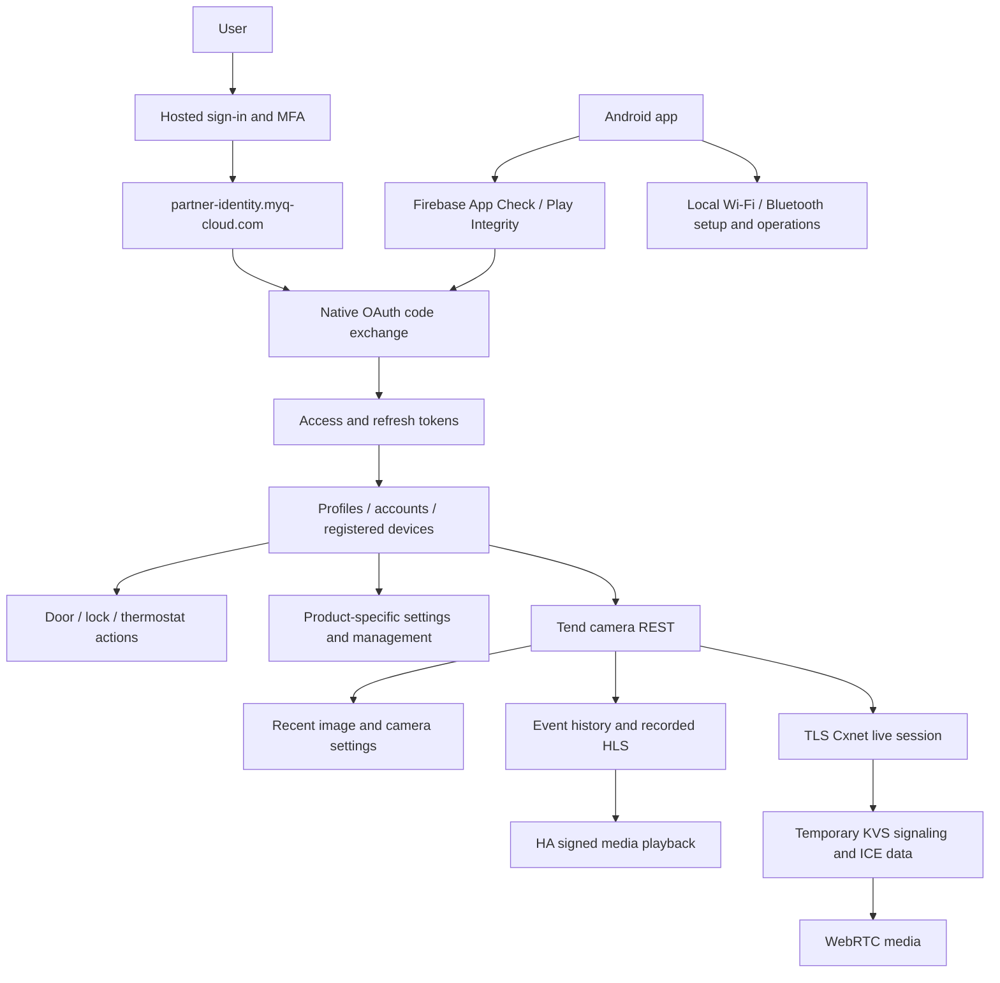

# MyQ API reference

What is known about MyQ's cloud services, recovered from the MyQ Android app
**5.324.0.1132442** (`com.chamberlain.android.liftmaster.myq`). It is not an
official specification. Most of it comes from static analysis and has not been
confirmed against a live account; the [research notes](../research/README.md)
record how it was gathered.

MyQ is a set of cooperating services: hosted OAuth sign-in, native app
verification, account and device services, product-specific control services,
Tend camera services, live signalling and media, and local Bluetooth and Wi-Fi
setup. There is no single endpoint that covers doors, cameras, locks,
thermostats and onboarding.

## Chapters

| Chapter | Contents |
| --- | --- |
| [Authentication](authentication.md) | OAuth and PKCE, hosted sign-in and MFA, Firebase App Check, the code exchange, refresh, sign-out rules, revocation and one-time sign-in links |
| [Services and routes](services.md) | Hosts and versions, request headers and conventions, discovery and action contracts, and an index of every declared route |
| [Devices](devices.md) | Accounts and the device model, device families and dispatch, doors, gates, lamps, opener settings, locks, thermostats, state confirmation and roles |
| [Cameras and video](video.md) | Camera identity and capabilities, snapshots, settings, sleep and wake, the Tend live handshake, Cxnet framing, and KVS WebRTC |
| [Recordings](recordings.md) | Event history, pagination, HLS and MP4 resources and their lifetimes |
| [Live controls](live-controls.md) | PTZ, siren and microphone commands, and the idle camera status connection |
| [Management](management.md) | Account grants, accessories, lock configuration and PINs, guest access, camera schedules |
| [Route catalog](api_catalog.json) | Every declared HTTP route, with source hashes, parameters and host context |
| [Original route inventory](api_inventory.json) | The first 464-entry extraction, kept for comparison |

## System overview

Arrows describe recovered relationships, not a single captured successful
session. Some camera types use different native media paths. Local provisioning
and Bluetooth-only operations are not replaced by cloud action calls.

## Findings at a glance

### Authentication

The identity host is **`partner-identity.myq-cloud.com`**, not `partner-identify`.
The Android client is `ANDROID_CGI_MYQ`, uses `MyQ_Residential offline_access`,
S256 PKCE, and returns to `com.myqops://android`. Its unified Custom Tabs path
differs from the older hidden-WebView/form path. Browser state, anti-forgery
fields and MFA form fields belong to the current transaction.

The app obtains a Firebase App Check token through a Play Integrity provider
and can attach it as `Firebase-AppCheck-Token` to the native authorization-code
exchange. Browser cookies, Cloudflare clearance, a public Firebase configuration
and a PKCE authorization code are different things; none alone substitutes for
the signed app-verification token. Refresh and additional auth-management
routes are documented with their own observed parameters.

Sign-in sessions end only when the token service answers `invalid_grant`,
`401.102` or `400`; other failures keep the session. A one-time sign-in link can
also create a session, without App Check. No accepted token exchange has been
observed; see the [sign-in investigation](../research/sign-in-investigation.md).

### Devices and actions

Account/device discovery and family-specific models distinguish residential and
commercial doors, gates, virtual doors, lamps, cameras, locks, thermostats,
gateways and accessories. `wifilockgateway` is a lock model despite its name;
camera-equipped locks also have separate camera records. Vendor lock/thermostat
types use suffix matching. Pet-door and placeholder names alone do not justify
reusing garage-door commands.

Doors use the action service with `open`/`close`, family `garagedoor` and trigger
`myq_an`. Lamps use the lamp service. Wi-Fi/Seam locks and gateway-connected
legacy locks follow different routes. Thermostat actions carry the unit and only
the temperature targets appropriate to their mode. Supported opener configuration
uses a separate GDO service. Capabilities, reported state, account authorization
and native UI restrictions are separate considerations.

An HTTP acknowledgement is not proof that a door moved, a lock changed state or
a thermostat accepted its target. The independent integration refreshes reported
state and avoids replaying uncertain mutations. Its command follow-up uses the
app's target states and tracking windows at a slower rate
([devices](devices.md#state-confirmation-roles-and-diagnostics)). These are
documented client policies, not evidence that all native app behavior is identical.

Management and media features follow the app's role gates (the app never reads
the AccountAccess permission lists). Typed accessory inventory/rename/assignment/removal, legacy remote
auto-relock/PIN operations, native Wi-Fi automatic-lock/calibrated-sensor settings,
existing guest access/removal, and camera workflow schedules have fresh authorization and readback
completion. Unknown roles and mismatched account/device associations do not
authorize writes. Provisioning and every native settings
screen's role semantics are not claimed complete. First camera workflow creation
is limited to the recovered model/capability gates; it does not establish general
provisioning parity.

### Video

Snapshots are authenticated Tend image requests, not a public camera URL.
Camera details expose settings, model-dependent capabilities and aliases.
Sleeping hardware can require a wake-up operation before live view.

The recovered KVS route first authenticates a TLS Cxnet session, selects mode 12,
and receives temporary signed signaling/ICE configuration. SDP and ICE then
travel over the KVS WebSocket; video/audio travel through WebRTC. The integration
relays that media to Home Assistant. Static transport recovery and local media
tests have succeeded; an actual MyQ camera stream has not been validated.
Manual PTZ/zoom/stop, siren activation and explicitly authorized KVS microphone
uplink are implemented with local watchdog/cleanup behavior. An optional HA
viewer card supports muted-by-default hold-to-talk. Existing cloud recordings
have a paginated account/camera browser and expiring authenticated HLS playback.
Read-only idle Tend monitoring and active live-session messages trigger REST
refresh, with polling fallback and bounded reconnect. Full-account door/lock
FCM still requires a genuine receiver/forwarder. Legacy RTP/P2P and physical compatibility remain
unverified, as detailed in the linked video implementation ledgers.

### API surface

The retained Java export yields **464 static declarations** across **69 source
files**: 363 ordinary Retrofit annotations, 9 generic HTTP annotations and 92
Tend/Seedonk table entries. There are **439 distinct literal method/path pairs**.
These counts include duplicates, old or generic library surfaces and paths whose
host/version is supplied elsewhere. They are not 464 verified MyQ operations.

The API chapter/catalog preserve declaration provenance and separate established
host mappings from unresolved ones. Service families include profiles/accounts,
devices/actions, doors/lamps/locks/gateways, partner HVAC, guest access/credentials,
scenes/schedules, notifications/history, provisioning, subscriptions/delivery,
camera media and local setup. Dynamic URLs and native protocols are not fully
represented by a Retrofit route inventory.

## How to interpret a finding

| Evidence class | What it establishes | What it cannot establish |
| --- | --- | --- |
| Packaged declaration | A manifest entry, API annotation, DTO, configuration or library is present in the selected bytes | That it runs, is enabled, or is authorized for an account |
| Static call-path trace | Readable methods connect an operation to a request/state transformation | Actual cloud response, timing or device behavior |
| Historical capture | The recorded requests/responses or TLS events occurred within that capture's coverage | Missing traffic, current service policy or a different platform's behavior |
| User-reported observation | The user observed an error or device/emulator state | The precise internal cause without corroborating evidence |
| Local implementation test | The integration produces/handles specified synthetic requests, responses or local media | A real MyQ session or compatibility with a physical product |
| Interpretation / design choice | An explicitly stated inference or conservative integration policy | An observed native rule unless independently traced |

Only version 5.324.0.1132442 was analysed. Other app versions, and the iOS
app, may differ.

