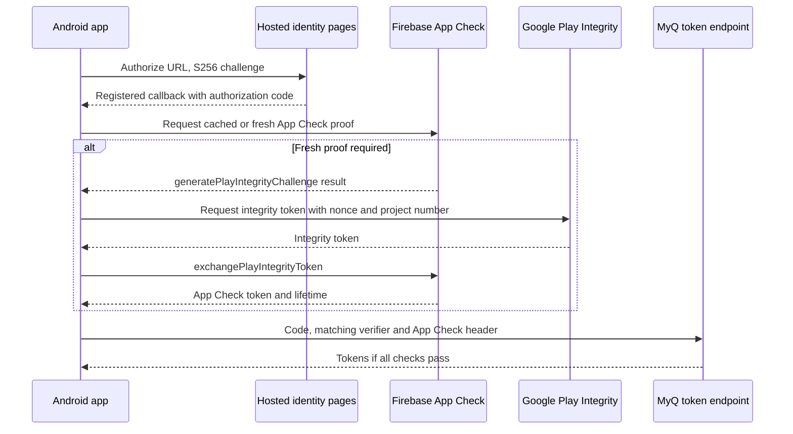

# Authentication

How MyQ sign-in and sessions work, from MyQ Android **5.324.0.1132442**: the
hosted sign-in pages, PKCE authorization, the native code exchange with Firebase
App Check, token refresh, sign-out and related operations. Source locations are
JADX paths in that build.

The identity host is **`partner-identity.myq-cloud.com`** (not
`partner-identify`).

The Android flow is hosted browser authorization with S256 PKCE, followed by a
native authorization-code exchange that carries a Firebase App Check token.
**No accepted token exchange has been observed in this project**, so the
session behaviour below is static analysis. The
[sign-in investigation](../research/sign-in-investigation.md) records what has
been tried.

## Protocol boundaries

There are four distinct credentials or states in this path:

| Item | Purpose | What it does not establish |
| --- | --- | --- |
| Browser cookies / verification state | Hosted identity pages, session and browser challenge handling | An API access token or native App Check proof |
| Authorization code plus matching PKCE verifier | One authorization transaction exchanged for tokens | A reusable session or valid app attestation by itself |
| Firebase App Check proof | App-verification input on the native code exchange | User login, a password substitute or device-control permission |
| OAuth access/refresh tokens | Authenticated service access and session renewal | Permission for every account, device or operation |

Clearing a browser challenge and obtaining a code therefore do not prove that
the native exchange will succeed. Likewise, a device being visible in discovery
does not prove that a guest may manage or actuate it.

## Hosted authorization request

`assets/myq-config.json` supplies production constants. `hp0/e.java` constructs
the identity service. The normal sign-in caller chain is:

```text
sp0/b (Android Custom Tabs)
  -> cp0/d
  -> ip0/j.c
  -> ip0/n.h
  -> ap0/AuthUrlParams
  -> ip0/k.G (authorization URL)
```

The request is an HTTPS GET to `/connect/authorize` with these values:

| Parameter | Native sign-in value |
| --- | --- |
| `client_id` | `ANDROID_CGI_MYQ` |
| `scope` | `MyQ_Residential offline_access` |
| `response_type` | `code` |
| `redirect_uri` | `com.myqops://android` |
| `code_challenge_method` | `S256` |
| `code_challenge` | Base64url SHA-256 of this transaction's verifier, without padding |
| `ui_locales` | Device language and country (`es0/c.c`); the integration sends HA's language and country, falling back to `en-US` |
| `acr_values` | `unified_flow:v1  brand:myq` for the inspected normal sign-in |
| `prompt` | `login` |

The two spaces in `acr_values` follow the app's empty signup slot. The constructor
uses `signUp=false`, `unifiedFlow=true`, `isMFA=false`. Bare `unified_flow` belongs
to the separate authenticated MFA-settings flow (`ip0/j.q`); it is not the same
as the normal sign-in parameter. A hidden-WebView credential-injection path
(`ip0/j.x`, `j0`, `i0(false,false)`) instead produces `acr_values=  brand:myq`.
The repository's email/password client now selects the unified path by default,
following the user-provided working reference. The legacy flag is retained for
explicit research calls. Both paths use this integration's state/PKCE checks.

The inspected Android URL builder does not add OAuth `state`. The integration
adds it as its own transaction-binding protection. It validates the exact
callback scheme/authority, callback path, a single matching state, one code,
optional expected issuer, transaction expiry and absence of a fragment. This
extra validation is an implementation choice, not a claim about the APK.

MyQ's credential-free OpenID discovery document advertised `/connect/authorize`,
`/connect/token` and S256 PKCE. A grant appearing in discovery does not prove
that this client may use it; no password-grant alternative has been established.
The [discovery URL](https://partner-identity.myq-cloud.com/.well-known/openid-configuration)
is a protocol reference, not a new fetch or current-service assertion in this
documentation pass.

## Password, SSO and MFA pages

A captured website sign-in showed this successful sequence on the
identity origin:

| Step | Method/path | Observed behavior |
| --- | --- | --- |
| Website entry | GET `/`, then `/Home/Secure` | Redirect through account selection to the email form |
| Password form | GET `/Account/LoginWithEmail?returnUrl=...` | Current cookies, action and hidden anti-forgery input |
| Domain SSO check | POST `/api/v1.0/externalaccounts/IsSSOEnabledForDomain` | JSON `email`; boolean `false` in that capture |
| Password submission | POST current `/Account/LoginWithEmail` action | `Email`, `Password`, `ReturnUrl`, `__RequestVerificationToken`; redirect to MFA |
| Email MFA | GET and POST `/AccountMfa/VerifyOtp?returnUrl=...` | Code form followed by successful redirect |
| Website landing | GET `/Home/Secure` | HTTP 200; a website session, not an API-token response |

The SSO JavaScript performs its lookup on email focus-out. The repository's
legacy diagnostic form transport checks once when that identity-origin script is
present, and reports SSO as unsupported if the result is true. The unified flow
submits the credentials directly, without emulating this focus-out event. The captured false
result establishes only that particular lookup, not global SSO availability.

The observed MFA form uses `Otp` plus the current hidden fields
`SelectedMfaMethod`, `IsSmsMethodEnabled`, `MaskedEmail`, `MaskedPhoneNumber`,
`__Invariant` and `__RequestVerificationToken`. Its script enables submission
after six digits. The parser was compared privately with the real form structure;
tests use synthetic sensitive values. SMS verification, enrollment, resend,
method switching and incorrect-code responses were not observed in that HAR.

The browser transport lets the hosted page perform these workflows. The raw
transport accepts only HTTPS identity-origin forms/redirects, preserves current
hidden fields and cookies, and refuses POST replay through 307/308 redirects.
It does not invent a new password endpoint or hard-code captured anti-forgery
values. Passwords, OTPs and captured cookies are not reused from HAR files.

A read-only review of the user-reported working checkout established additional
unified-flow behavior. The current parser selects unambiguous email/password
and OTP controls from their metadata. On `/AccountMfa/VerifyOtp`, a single code
input can also be identified from that endpoint's context. Readonly and disabled
controls are not chosen for credentials or OTPs; checked fields and repeated
values are preserved in submissions. If that page reports SMS selected and
email is not explicitly disabled, setup requests `selectedMfaMethod=Email` once.

After MFA, the known `/Consent` form is submitted with its current controls and
`button=yes`. When it returns a page instead of redirecting, the client resumes
the form action's `returnUrl` only if it is the identity service's exact
`/connect/authorize/callback` route. Consent is not automatically replayed after
an uncertain result. Validation-summary and field-validation errors are detected
without displaying their potentially sensitive text. These behaviors were
implemented in the existing state machine and tested with new synthetic pages;
reference code and fixtures were not copied.

### Browser challenge versus API rejection

Anonymous requests to the authorization page can receive HTTP 429 with HTML
and `cf-mitigated: challenge`, without `Retry-After`. That marker identifies a
Cloudflare browser check, not an ordinary rate limit. Browser verification and
Firebase App Check are different stages.

The integration reports `BrowserVerificationRequired` for the raw transport;
the interactive helper leaves the page open for its ordinary scripts and user
interaction. It does not implement a CAPTCHA solver. Attempts to pass the check
with browser TLS profiles are recorded in the
[sign-in investigation](../research/sign-in-investigation.md#browser-verification).

## Native authorization-code exchange

On callback, `sp0/b.b` forwards the attestation provider, and `ip0/n.r` awaits
it before `ip0/k.E` sends the exchange. The endpoint and body are:

```text
POST https://partner-identity.myq-cloud.com/connect/token
Content-Type: application/x-www-form-urlencoded
Firebase-AppCheck-Token: <genuine current proof>

client_id=ANDROID_CGI_MYQ
scope=MyQ_Residential offline_access
grant_type=authorization_code
code=<fresh authorization code>
redirect_uri=com.myqops://android
code_verifier=<matching verifier>
```

These are field names and placeholders, not reusable credentials. The inspected
builder has no `client_secret` field. The Retrofit declaration is `ip0/s.g`.
The expected response DTO `ap0/AuthLoginDto.java` carries access token, refresh
token, lifetime and token type. No successful live response or actual issued
lifetime has been observed here.

`y92/b.s` provides common native metadata and `ft0/i0` applies it:

| Header | Observed native source/value | Repository behavior |
| --- | --- | --- |
| `BrandId` | `1`; `yk/a0` through `sa2/b` | Included on token and supported MyQ account/device requests |
| `App-Version` | `5.324.0.1132442`; `yk/b0` through `ta2/f` | Tied to the analyzed protocol build |
| `User-Agent` | Android model plus `/Android ` and OS version | Measured runtime identity: `sdk_gphone64_arm64/Android 17`; the AVD display name is not Build.MODEL |
| `Accept-Encoding` | `gzip`; OkHttp `BridgeInterceptor` | Native requests use gzip only |
| `Connection` | `Keep-Alive` on HTTP/1; omitted by OkHttp's HTTP/2 codec | Included for the integration's native HTTP/1 requests |
| `Authorization` | Bearer access token on authenticated service requests | Added for authenticated calls, not a substitute for code-exchange proof |

Native requests suppress automatic `Accept`, browser fetch/client-hint headers
and browser cookies. The inspected app's native OkHttp client uses `NoCookies`;
its browser authorization session is separate. HA uses a separate native curl session with the measured Android TLS/HTTP2
profile. Browser navigation uses the working reference's mobile Chrome identity, and native metadata
is not added to Tend camera requests.

Code exchange, refresh and revocation use the inspected OkHttp form escaping:
spaces become `+`, literal `+` becomes `%2B`, `~` becomes `%7E`, and `*` stays
literal. The form examples above show decoded fields, not encoded wire bytes.

The native TLS ClientHello and principal HTTP/2 settings have been compared
with a local replay using the APK's OkHttp on Android. Complete network
identity and MyQ acceptance remain unverified. Firebase debug-token acquisition
is implemented and separately verified. The
[Android request profile evidence](../research/android-request-profile.md)
records the source locations, profile choice and remaining differences.

## Firebase App Check and Play Integrity

`MyQToolsInitializer` and `ml0/k` supply the attestation provider.
`BackgroundDeferredInitializer` configures Firebase production behavior, while
`hu/a.b` registers `hr1/b`, the Play Integrity provider factory.



`ml0/f.a` initially requests `forceRefresh=false`. Firebase's cache check in
`er1/j.p` reuses proof only when more than **300,000 milliseconds** remain.
MyQ retries acquisition with forced refresh if its callback receives an expired
token. The release-specific MyQ cache (`ml0/l`, selected by `ml0/k.i`) is a
no-op, while the Firebase SDK still has its own cache. Debug preferences named
`app_check_token_value` are not evidence of a release proof source.

The Firebase SDK declares these request templates (`er1/o.java`):

```text
https://firebaseappcheck.googleapis.com/v1/projects/{project}/apps/{app}:generatePlayIntegrityChallenge?key={apiKey}
https://firebaseappcheck.googleapis.com/v1/projects/{project}/apps/{app}:exchangePlayIntegrityToken?key={apiKey}
```

`ir1/i` obtains the challenge, passes its nonce and cloud project number into
Play Integrity, and exchanges the result. Firebase requests use JSON,
`X-Android-Package`, `X-Android-Cert` and optional `X-Firebase-Client` heartbeat
metadata. Those are Firebase-side headers; the MyQ token exchange uses the
distinct `Firebase-AppCheck-Token` header. The inspected ordinary provider path
does not set `limited_use` (`ir1/a`, `ir1/i`). Server replay policy was not
observed.

The APK's public Firebase configuration is not a signed attestation. Neither
browser HAR contained an App Check header or App Check service request. Their
Firebase bundles initialized Analytics/Installations; generic SDK component-name
strings did not establish web App Check acquisition. There is no verified way
in the current evidence to obtain the needed proof from those browser sessions.

### Native provider failures

`ip0/k.E` has three branches:

| Result | Native exchange behavior | Interpretation |
| --- | --- | --- |
| Acquired token | Sends that token in the custom header | Configured normal path |
| Provider failure | Sends literal `ERROR_RETRIEVING_TOKEN` | Failure marker, not evidence of accepted proof |
| Provider unconfigured | Omits the App Check header | SDK fallback, not an established production login path |

`ml0/f` preserves a Google `IntegrityServiceException` numeric code but assigns
the app-defined value **`-998`** to the App Check `xq1.m` exception class.
`ip0/n`/`ft0/o0` carry provider failures as local `401.122i`; `hp0/c` renders
that as `401.122 (<provider code>)`. Firebase API errors, unexpected responses
or throttling can reach that exception category. Consequently, the displayed
`401.122 (-998)` alone does not reveal the exact integrity verdict.

The separate server code `401.122` is handled as application rejection, while
`invalid_grant` and `401.102` participate in invalid-token/refresh handling
(`ip0/j`). Neither a 429 challenge nor this application rejection is evidence
that the user's password is incorrect.

## Refresh, persistence and sign-out surfaces

Native refresh uses the same token endpoint:

```text
POST /connect/token
IsRefresh: true

client_id=ANDROID_CGI_MYQ
grant_type=refresh_token
refresh_token=<current refresh token>
```

`ip0/s.i` marks the request, and `ft0/t0.b` builds its form from the token
manager. This inspected refresh path does not request or attach App Check.
That static difference is not proof that future service policy never changes.
The interceptor order is `ft0/g0`, `ft0/g1` (which hands OAuth requests to
`ft0/t0`), then `ft0/i0`, so the header interceptor also adds the stored, usually
expired, access token as `Authorization: Bearer` to the refresh request.

### When the app signs out

The app keeps its session through most failures:

| Situation | App behavior | Source |
| --- | --- | --- |
| Access token past its effective lifetime | Renew before sending (one renewal shared by concurrent requests); on a failed renewal, send anyway | `ft0/g1`, `rt0/g` |
| Refresh answer `error=invalid_grant` or `code=401.102` | Sign out, unless another request rotated the refresh token meanwhile | `ip0/j.f91078u`, `J0`, `g0`, `b0`; `ip0/p.b` |
| Refresh answer `code=400` | Sign out (`TokenManager.d`) | `ft0/g1`, `ft0/c1.f` |
| Any other refresh failure (other 4xx, 5xx, network, empty body) | Stay signed in; try again on the next request | `ip0/j.J0` |
| Service 401 with body code `401.102` or `401`, or no code | Renew (or reuse a token another request just renewed) and send once more, for any method | `ft0/c1` |
| Service 401 with any other code, or a second 401 | Fail that request; stay signed in | `ft0/c1` |

`ip0/j.I0` updates access and refresh tokens, lifetime, expiry and listeners
after success. Its native effective lifetime calculation (`z0`) is:

```text
max(floor(0.95 * token_lifetime_seconds), token_lifetime_seconds - 300)
```

It converts that result to milliseconds. A 3,600-second fallback exists when
the DTO omits lifetime; this is a native default, not an observed server-issued
lifetime. `bp0/a` defines the auth store and `bp0/b` writes token values through
its secure-settings abstraction, keeping timing values in the ordinary settings
store. This bounded trace does not establish the concrete on-disk cryptography,
backup behavior or every migration path. No installed app's stored credentials
were read.

Additional auth-service operations are statically declared and partly mapped:

| Operation | Request | Evidence and boundary |
| --- | --- | --- |
| Token revocation | POST `/connect/revocation`, form `client_id`, `token_type_hint=refresh_token`, `token`; authenticated, so a Bearer access token is attached | Sign-out: `gp0/f.d` → `ip0/j.f` → `ip0/k.N` → `ip0/s.h`, then the store and cookies are cleared. The integration sends it when its entry is deleted; no live invocation observed |
| One-time sign-in | POST `/api/v1.0/auth/token`, form `client_id`, `Authorization: Bearer <one-time token>`, no App Check header | App Link `https://www.myliftmaster.com/ids/auth/onetime-login?token=…` (also `www.gomerlin.com.au`) → `gm0/a.N` → `LoginActivity.L2` → `gp0/f.h` → `ip0/j.g`, which stores the token as the access token so `ft0/i0` sends it. The response is a normal `AuthLoginDto`. Gated by the `enable_onetime_authorization` feature flag (`WelcomeActivity.y1` → `ra2/c.Q0`). Where MyQ issues these links was not found. Offered as a setup option until November 2026, when the link's web page began saying web login is no longer supported; never used live |
| Change password | POST `/api/v1.0/Login/UpdatePassword`, JSON `CurrentPassword`, `NewPassword`, `RefreshToken` | `ip0/k.P/Q`, `ip0/s.e`, `ap0/UpdatePasswordV6Dto`; default version v1.0 despite the DTO's V6 name; no integration write |

Deleting the integration entry now sends the revocation above for that entry's
own session, once and best effort. Native account deletion, password-reset
screens and all their recovery paths have not been fully traced.

## Home Assistant implementation boundary

The following behavior belongs to this repository, with synthetic/local tests:

- HA setup and reauthentication open directly to email/password, followed by
  MFA when requested. Browser handoff, refresh-token import and manual proof
  fields are no longer offered. The form keeps OAuth state and the PKCE verifier
  in memory; transactions expire after ten minutes and are lost on restart or
  cancellation. `FirebaseDebugAppCheckProvider` obtains proof automatically using
  the private registered credential in HA's `myq_app_check.json` file.
- The research API retains `SuppliedAppCheckProvider` for externally supplied
  proof. `FileAppCheckProvider`
  reloads externally maintained proof; `CachedAppCheckProvider` wraps an external
  async loader. The Firebase provider exchanges a registered debug token; it does
  not mint Play Integrity proof or create Firebase registrations.
- Providers require more than five minutes of remaining validity, using locally
  decoded JWT expiry only as a freshness hint. They do not verify the signature
  or establish authenticity. Acquisition has a timeout and concurrency guard.
- Proof preparation precedes the one-shot code claim. After awaited acquisition,
  the transaction and proof are checked again under the token-manager lock.
  Once HTTP exchange starts, cancellation or uncertainty cannot replay the code.
  `401.122` invalidates cached proof and requires a new transaction.
- Tokens rotate under a lock and are persisted through HA's config-entry storage.
  Access tokens renew at the native effective lifetime; sessions saved before
  the lifetime was recorded renew 60 seconds before expiry. A token response
  without `expires_in` is kept with the native one-hour default, `token_type` is
  ignored as the app ignores it, and an omitted refresh token keeps the current
  one, so a rotation is never discarded.
- Sign-out and retry follow the table above. Only `invalid_grant`, `401.102` or
  `400` from the token endpoint asks for a new sign-in; any other refusal keeps
  the session and polling retries it. A renewable service 401 is renewed and
  sent once more for any method, commands included, because MyQ did not act on
  it. Other failures, such as timeouts, are never replayed.
- App Check is not persisted in OAuth tokens or HA config entries and is not
  attached to refresh, device or camera calls. Passwords, MFA codes, browser
  cookies and private media are excluded from diagnostics. A helper result file
  remains sensitive until the user removes it.
- Setup verifies profile identity and discovery before saving the integration.
  Reauthentication cannot replace an existing entry with a different account.
  A discovery failure after form sign-in offers a retry with that same session,
  without repeating password/MFA or the code exchange.
- Deleting the entry revokes its session (above), bounded to 15 seconds.

The setup code is in `config_flow.py`, `api/auth.py`, `oauth.py` and `tokens.py`.
Operational instructions are in the [sign-in guide](../sign-in.md).
`app_check.py`, `handoff.py`, `browser.py`, `har.py` and the standalone scripts
retain research support for externally supplied proof and sessions; those are
not Home Assistant setup options. No genuine working session is available here.

## Sources and open questions

The key source locations are `hp0/e`, `sp0/b`, `cp0/d`, `ip0/j`, `ip0/n`, `ip0/k`,
`ip0/s`, `ip0/p`, `ip0/r`, `ap0/AuthUrlParams`, `ap0/AuthLoginDto`,
`ap0/UpdatePasswordV6Dto`, `ml0/f`, `ml0/k`, `ml0/l`, `hu/a`, `hr1/b`, `ir1/i`,
`ir1/a`, `er1/j`, `er1/o`, `ft0/c1`, `ft0/g1`, `ft0/i0`, `ft0/t0`, `ft0/o0`,
`rt0/g`, `hp0/c`, `y92/b`, `bp0/a` and `bp0/b`. Obfuscated names are specific to
this build.

Still unknown: MyQ's App Check verdict policy, whether a token obtained
elsewhere is accepted, real session lifetimes and revocation behaviour, where
one-time sign-in links are issued, and how iOS attests. The decisive missing
evidence is one accepted exchange with a fresh code, its matching verifier and a
genuine App Check token, followed by read-only profile, device and refresh
checks.
