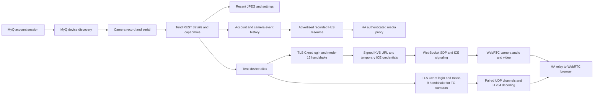

# Cameras and video

How MyQ cameras work in Android **5.324.0.1132442**: camera identity and
capabilities, snapshots, settings, sleep and wake, the Tend live handshake,
Cxnet framing, and KVS WebRTC signalling and media. The TC mode-9 section also
uses protocol observations from the referenced camera implementations. The new
TC transport has local tests only; its live operation remains unverified. The
[camera guide](../cameras.md) describes what the integration offers.

## The camera system has several distinct layers

Camera operations are not all requests to the ordinary MyQ device-action API.
The app combines account/device discovery, Tend REST resources, Tend's Cxnet
signaling protocol, and a selected media transport. Newer cameras can use AWS
Kinesis Video Streams WebRTC, while older paths remain in the bundled Tend SDK.



The diagram shows both live routes and the separate recorded-event path.
It does not imply that all camera products or accounts expose them.
Video-call, recorded-media and older SDK/native interfaces cannot be substituted
for the live-view handshake just because their paths contain `video` or `webrtc`.

## Device identity, association and capabilities

Ordinary MyQ discovery returns a device serial, family, type, capabilities and
state. Camera types include integrated garage cameras, indoor/outdoor cameras,
battery cameras, doorbells, keypads, PTZ/floodlight/worklight cameras, and camera
components of locks or pet doors. The [device inventory](../research/device-families.md) lists the
observed identifiers and regional aliases.

Two identifiers have different purposes:

| Identifier | Purpose | Source |
| --- | --- | --- |
| Tend device `id` | REST path identifier | `je1/a.java` derives it by stripping the MyQ serial prefix through its final hyphen; `TendDevice.getDeviceId` |
| Tend device `alias` | Live signaling destination | `g41/TendDeviceInfo.java`, `TendDevice.getDeviceAlias`; the alias is not interchangeable with the REST ID |
| Tend user alias | Viewer identity obtained by Tend login | `SeedonkAuthManager`, `ConnectionManager` and the Cxnet login response |

A camera-equipped opener and its camera can be separate records. The integration
requires a returned camera record; an opener's camera reference alone does not
create a guessed camera entity. Likewise, a smart-lock camera record does not
establish a lock actuator. The lock component has its own record and protocol.

`g41/TendDeviceInfo.java` and associated DTOs provide `settings`, `cap`, `status`,
`hw` and `net`. `g41/TendDeviceCapabilitiesDto.java` separates capability sections
such as `cam`, `mic`, `spk`, `lightList`, `siren`, `statusLed`, `doorbell`, `chime`,
`pwr`, `wakeOnMotionCap`, `autoSecure`, `wifiExtend`, `gateway`, `dvr`, `event`
and `util`. A named section does not establish that every setting within it is
available. Returned capabilities and current typed settings govern entity
creation; cloud authorization remains separate.

## Tend REST and snapshot requests

The recovered production camera base is
`https://media.hubs.tend-us.tendplatform.com`. The ordinary REST path prefix is
`/cxs/api`. The authenticated client uses `Authorization: Bearer <access-token>`
and the literal header `AntiCSRF: AntiCSRF`. This is a distinct client setup
from MyQ account/device requests; the integration does not add its native
BrandId/App-Version headers to the Tend host.

| Method and relative path | Meaning | Evidence |
| --- | --- | --- |
| `GET /cxs/api/devices/{id}` | Details, status, hardware, capability and setting groups | `f41/a.java:l`, `j41/a.java`, `g41/TendDeviceInfo.java` |
| `GET /cxs/api/devices` | Tend device-list declaration | `f41/a.java:g`; integration discovery currently starts with MyQ account devices |
| `GET /cxs/api/devices/{id}/net` | Network-detail declaration | `f41/a.java:a`; not separately exposed by the integration |
| `GET /cxs/api/devices/{id}/cam/recentImage.jpg?size=HD&forceRefresh=true` | Request a refreshed snapshot | `wy/o.java:e`, `hj0/m.java:z,g`, `xr0/v.java` |
| `GET /cxs/api/devices/{id}/cam/recentImage.jpg?size=FHD&forceUseExisting=true` | Request the existing recent image | `hj0/m.java`, `com/chamberlain/myq/features/places/view/e.java` |
| `PUT /cxs/api/devices/{id}/settings` | Partial settings payload | `f41/a.java:b,k`, `e41/n.java:G,E`, `i41/e.java:b`, `h41/` DTOs |
| `POST /cxs/api/devices/{id}/do/wakeup` | Wake a camera before live view; SDK request sends `{}` | `DevicesManager.wakeup`, `HttpMyqCoreRequestManagerImpl`, `wf1/f.java:e`, `vf1/g.java:a` |

The app reads a `tend-dttm` response header in `hj0/c0.java`. The presence of a
refresh request, HTTP success or JPEG bytes does not prove the image was
captured at request time. Actual freshness, timestamp semantics and entitlement
behavior remain unverified.

The HA camera entity follows the app's mode choice (`forceUseExisting` for
battery cameras, `forceRefresh` otherwise, with fallback either way and the
24-hour capture-time refresh), validates a JPEG signature, coalesces concurrent
image requests, and caches the result for 60 seconds. While a live view is open
it returns the newest live frame instead. Cached and in-flight images are
invalidated when the camera is turned off, becomes unavailable or is removed.
See [cameras.md](../cameras.md) for the details. The integration does not save image files automatically; HA's
ordinary snapshot action may save one to a user-selected permitted destination.

## Camera settings and native payloads

`e41/n.java:G` maps the app's explicit settings payload through `i41/e.java:b`
and calls `f41/a.java:b`. DTO fields are nullable, allowing selected sections
to be emitted. The server's handling of these partial updates still needs
authenticated validation. The integration reads current details before writes,
uses allowlisted payload shapes and does not treat acknowledgment as confirmed
device state.

| Feature | Required returned evidence | Payload shape |
| --- | --- | --- |
| Camera enable/privacy | `cap.cam.enableSwitch` and typed current enabled setting | `{"cam":{"enabled":true}}` |
| Motion detection | `cap.cam.motion` and typed current setting | `{"cam":{"motionEnabled":true}}` |
| Microphone enable | Microphone capability section and typed enabled setting | `{"mic":{"enabled":true}}` |
| Speaker volume | Integer `cap.spk.volMin` / `volMax` and current volume | `{"spk":{"vol":N}}` |
| Motion sensitivity | Motion capability and valid `motionSensMin` / `motionSensMax` | `{"cam":{"motionSens":N}}` |
| Siren volume | Valid `cap.siren.minVol` / `maxVol` and current volume | `{"siren":{"vol":N}}`; this does not activate the siren |
| Image orientation | Advertised `rotationList` and understood current representation | `{"cam":{"rotation":value}}` |
| Night vision | `cap.cam.ir` and understood current representation | `{"cam":{"ir":value}}` |
| Status LED | `cap.statusLed.ledOnOff` and current `ON` / `OFF` | `{"statusLed":{"status":"ON"}}` |
| Doorbell chime enable | Current chime type is advertised; enabled/duration fields valid | `{"chime":{"enabled":true,"type":existing,"duration":existing}}` |
| PTZ auto tracking | Advertised auto-tracking capability and typed current settings; camera enabled | `{"cam":{"ptz":{"autoTracking":{"enabled":true,"objects":existing}}}}` |
| Camera light | Matching light capability/settings arrays; advertised on/off | `{"lightList":[...]}` with positional entries preserved |

The numeric orientation mapping is normal=1, mirror=2, mirror_flip=3, flip=4.
IR is off=0, on=1, auto=2. SDK setters use numeric values, while modern DTOs
use named enums. The integration preserves the understood response
representation; acceptance of either representation has not been observed
against a real camera.

Each native light-list entry contains `switchState`, `intensity`,
`motionTrigger` and `triggerDuration`. The integration preserves every entry
and the untouched fields. Brightness is enabled only with `setIntensity=true`
and a valid advertised integer range. HA brightness 1–255 is mapped to that
range; zero means off. Native `program` state does not establish whether the
light is currently illuminated, so on/off state remains unknown in that case.
These camera lights are distinct from a garage opener's worklight timer/PIR
settings and from standalone lamps.

Resolution, frame rate and quality are readback sensors. Although capability
lists and older SDK setters exist, modern `i41/c.java:b` does not emit these
fields on the reviewed settings path. The implementation therefore does not
infer writable controls. Full field-by-field source anchors and coupled-setting
limits are in [camera settings evidence](../research/devices-camera-evidence.md).

## Sleep and wake-up

`TendDevice.checkRequiresWakeup` selects wake-up for a positive
`status.pwr.sleepInterval` or one of eight battery platform identifiers. The
hardware identifier is the second colon-delimited component of `hw.platform`,
not a human-readable `hw.model` name:

```text
GT-RTL8735BDM-II                 GT-RTL8735BDM-III
PMX-SAV524MT7686-STM-I           PMX-SAV524MT7686-STM-II
PMX-SAV524MT7686-STM-III         PMX-SAV524MT7686-STM-IV
KDS-SAV524MT7686-CYPHS-I         KDS-SAV524MT7686-CYPHS-II
```

Native source anchors are `qf1/c.java`, `TendDevice`, `wf1/f.java:e` and
`vf1/g.java:a`. The relevant power states include `FULL_POWER`,
`LOW_POWER_DEEP_SLEEP` and `FULL_POWER_BOOT`. The integration requires online
status and full power before proceeding on a wake-required camera.

Android waits for SDK status pushes with a 30-second fallback read. HA pauses
its read-only idle status connection before live startup, sends the wake POST
once and re-reads details every 3 seconds for up to 30 seconds. Before a settings
write, a camera that is not AVAILABLE is woken the way `mz0/b` does it (every 2
seconds for up to 15); the write then proceeds if the camera still reports online. This
polling substitution is an integration choice. A failed or timed-out wake
aborts live viewing; neither wake-up nor start is automatically repeated.

Understood alias-scoped Tend messages invalidate camera details and request
REST refresh in both idle monitoring and active live views. The idle monitor
only logs in, reads and keeps the connection alive; it does not wake a camera
or request media. It tracks cameras with viewing grants, pauses before live
view, resumes after cleanup and closes on unload. Bounded reconnect delays and
ordinary polling provide recovery. This does not implement door/lock
notifications or full-account FCM. See the
[status-monitor ledger](live-controls.md#read-only-idle-camera-status).

## Native live-view handshake

The app selects mode 12 using `cap.cam.kvsWebRTC` and the remote feature flag
`enable_mode12_live_streaming` (`f81/g.java:a,b`, `ag1/a.java:h`). The integration
uses the explicit camera capability and alias; it does not import the app's
remote rollout flags. A true `cap.cam.kvsWebRTC` always selects mode 12. A known
TC camera serial with that capability false or absent selects the mode-9 route
described below; a missing KVS capability alone does not establish that a camera
cannot stream. Malformed capability values and other unknown camera routes do
not enable live viewing.

```mermaid
sequenceDiagram
    participant V as Viewer/session coordinator
    participant R as Tend REST
    participant T as Tend TLS/Cxnet
    participant K as KVS signaling
    participant C as Camera WebRTC peer
    V->>R: Get details; wake if required
    R-->>V: Online/full-power status and alias
    V->>T: TLS login, action 519, MyQ access token
    T-->>V: User alias and session routing fields
    V->>T: Action 411: require-video-send, alias, mode 12
    T-->>V: accept-video-receive + serverOpt.kvs
    V->>K: Open supplied signed WSS URL
    V->>K: SDP_OFFER and ICE_CANDIDATE messages
    K-->>V: SDP_ANSWER and ICE_CANDIDATE messages
    C-->>V: Negotiated camera audio/video
    V->>T: Keepalive while session remains active
    V->>T: stop-video-receive; logout on close
```

Tend signaling uses raw TLS to `server.seedonk.com:5104`, not an HTTP request
to a similarly named servlet. Sources are `TendAuthHost`, `ConnectionManager.setComm`,
`eg1/b.java` and `cg1/a.java`. The SDK supports redirects. The integration
accepts bounded redirects only within `seedonk.com` and `tendplatform.com`,
keeps TLS certificate validation enabled, and rejects unknown destinations.
Those destination restrictions are integration policy, not a claim that every
SDK redirect branch has the same restriction.

The APK's Android network-security resource also declares a set of 39 SHA-256
pins for a domain group covering `seedonk.com`, `isecurityplus.com`,
`tendinsights.com` and `tendplatform.com`, including subdomains. A more-specific
`api.prod.tendplatform.com` configuration declares system trust anchors without
its own pin-set. These are packaged configuration facts, not proof that every
native SDK TLS socket uses Android's same trust path. The Python integration
uses normal certificate validation and does not reproduce that pin-set.

Authentication is Cxnet action **519**. `SeedonkAuthManager.attemptLogin` /
`getTendSessionId` and `ConnectionManager.login` use an empty username and the
password value `myQ.accessToken:<OAuth-access-token>`. The request is not the
user's account password. Login fields include `CX_UNAME`, `CX_PASSWD`,
`partner-id`, `sdk_version`, `current_version`, `app-id`, and OS metadata.
Java Properties encoding is used for option/data fields, including escaping.
Successful login yields a user alias and session routing fields.

| Operation | Cxnet action / text | Evidence |
| --- | --- | --- |
| Login | `519` | `SeedonkAuthManager`, `ConnectionManager.login` |
| Send command | `411`, destination option `CX_DSTID`; correlation metadata | `f81/c.java`, `f81/d.java`, `ConnectionManager.sendCxnetCommand` |
| Start KVS view | `require-video-send\|{userAlias}\|12\|` | `f81/b.java`, `f81/c.java` |
| Receive acceptance | Direct action `438` or message within action `501`; `accept-video-receive` for the expected alias/mode | `f81/b.java:t,x`, `eg1/b.java`, `CommandHandler` |
| Keepalive | `526`, 35-second interval | `ConnectionManager`, `eg1/b.java` |
| Stop view | Action `411`, `stop-video-receive\|{userAlias}\|12\|` | `f81/b0.java:j`, `f81/c.java` |
| Logout | `408` | `ConnectionManager`, `eg1/b.java` |

The start coordinator waits five seconds for acceptance. The implementation
matches the camera alias and mode rather than accepting an unrelated push.
The response's server-options JSON contains `kvs`. Denial, kick-out, signaling
loss, malformed frames or timeout end the attempted view.

## Legacy TC live video

The TC route uses the existing authenticated TLS/Cxnet session with video mode
**9**. It requires exactly one matching camera destination in the authenticated
`device-info-list`; it does not select another camera when that alias is absent
or ambiguous. The registration supplies the camera address and optional AES
material, while the matching acceptance supplies the RTP relay endpoint.

Paired UDP media/control channels perform Tend's rendezvous and receive camera
media. The receiver assembles the proprietary fragments, validates the RTP and
`w1` media envelope, decrypts AES-CBC/PKCS#7 payloads when indicated, and extracts
H.264 records. Decoded frames enter the existing native HA WebRTC relay and
shared live-snapshot path. This implementation adds no loopback HTTP or live
HLS source. Legacy audio and talkback are not implemented.

The fragment wrapper has an observed little-endian 32-bit group identifier at
bytes 0–3. The meaning of bytes 4–7 remains unresolved: the older PR's synthetic
fixtures and upstream talkback sender do not establish a consistent index/count
contract for received video. The receiver bounds arrival-order assembly and
suppresses duplicate datagrams. It does not guess those fields or claim to
repair out-of-order fragments; packet loss or reordering can still discard a
frame.

Katherine reported working live video on both openers with the other
integration's v0.2.8 release in
[PR #7](https://github.com/bvdcode/home-assistant-myq/pull/7#issuecomment-6607828120).
That is evidence for the TC route, not for this new code's physical operation.
The implementation was written afresh using protocol observations; reference
implementation code was not copied. Local regression tests cover the new
negotiation, media and relay behavior; live validation remains outstanding.

## Cxnet framing

`fg1/h.java` (`CxnetParser`) and `fg1/f.java` define a **27-byte fixed header**
followed by the sender/routing block, options and data. Numeric fields use
little-endian order. The implementation encodes the fixed header with
`<BBHHBIHHH2sQ`; its reviewed outgoing layout is:

| Byte offset | Width | Field / reviewed value |
| --- | --- | --- |
| 0 | 1 | Package marker, 65 (`A`) |
| 1 | 1 | Version, 3 for outgoing frames |
| 2 | 2 | Header length including sender and options |
| 4 | 2 | Sender block length, 16 in implemented session path |
| 6 | 1 | Header field emitted as 0 |
| 7 | 4 | Data length |
| 11 | 2 | Header field emitted as 121 |
| 13 | 2 | Action/opcode |
| 15 | 2 | Crypto/mode field emitted as 2 |
| 17 | 2 | Marker bytes `**` |
| 19 | 8 | Recipient/routing value |

The native parser accepts versions 1–3 and sender blocks that are multiples
of 16 bytes. The integration intentionally implements the observed 16-byte
session case, not all Cxnet variants. It caps data at 1,024,000 bytes and checks
declared lengths before reading payloads. A field named crypto/mode does not
establish a separate encryption scheme here; transport TLS is distinct.

Action 438 conveys direct command content with server options. Action 501
contains batched records with a one-byte kind and four-byte little-endian length
before each record's payload. The implementation extracts understood command
records and keeps binary/legacy media payload actions out of its string parser.
Legacy UDP media is decoded separately from this signaling parser.

## KVS credentials, WebSocket messages and media

`j81/KvsModel.java` declares `channelUrl`, `channelArn`, `channelName`,
`endpoints`, `iceServers` and `region`. Each `j81/IceServerModel.java` contains
`urls`, `username`, `password` and optional `ttl`. These arrive through the
accepted native session; the integration neither invents AWS credentials nor
derives a permanent public camera URL.

The signed `channelUrl` is used as supplied. Its query is preserved without
normalization that could alter a signature. MyQ OAuth headers and cookies are
not sent to AWS. The integration validates the WSS scheme, region-specific
Kinesis Video hostname and ICE URI shapes, blocks HTTP redirects/handshake
replay, and checks connection credential freshness. These checks are local
implementation constraints; they are not a complete model of every regional
AWS deployment.

Native source for the following envelope is under
`com/chamberlaingroup/video/webrtc/liveplayer/webrtcplayer/signalling/kvs/`,
especially `KvsSignallingService.java`, `messaging/WebSocketMessage.java` and
`messaging/KvsEventParser.java`:

```json
{
  "action": "SDP_OFFER",
  "messagePayload": "<Base64url-encoded JSON payload>",
  "senderClientId": "<session client ID>",
  "recipientClientId": ""
}
```

Outgoing offer payload is `{"type":"offer","sdp":"<SDP>"}`. Separate
`ICE_CANDIDATE` messages carry `candidate`, `sdpMid` and `sdpMLineIndex`.
Outgoing JSON is Base64url encoded with padding. Incoming envelopes use
`messageType`, with `SDP_ANSWER` and `ICE_CANDIDATE` payloads decoded from Base64.
The implementation bounds message/SDP/candidate sizes and rejects unexpected
repeated answers. `GO_AWAY`, `RECONNECT_ICE_SERVER` or rejected signaling
responses terminate the current integration session; it does not automatically
reconnect.

`j81/d.java` and the native media configuration select **H.264 video** and
**G.711 PCMU/PCMA audio** for the reviewed route, with receiving transceivers and
no data channel. Temporary ICE servers supply STUN/TURN connectivity. Whether
a particular view uses a direct connection or a relay depends on actual ICE
negotiation and has not been observed for the user's camera.

`h81/KvsCredsPushDto.java`, `h81/d.java`, and the KVS connection manager show
pushed credentials and warm/idle signaling state. The native expiry sweep skips
busy channels. A signed URL's connection expiry therefore does not establish
the maximum lifetime of an already active media session. The integration checks
freshness when connecting, does not prewarm channels, and uses a separate local
view-duration policy.

## Home Assistant implementation choices

The native app's player and the independent HA implementation are different
runtime systems. The integration's design should not be attributed to the app:

| Integration decision | Reason / practical result |
| --- | --- |
| Separate camera input and browser-facing `aiortc` peers | KVS uses a camera-facing peer with returned ICE credentials; TC uses a decoded UDP video track. Both feed the existing browser-facing relay. Browser-facing ICE comes from HA. |
| Receive media by default; explicitly enabled KVS talkback | KVS viewing receives supported camera audio/video. The optional microphone card offers an audio uplink, muted until fresh authorization and explicit activation; a 30-second local timeout mutes it. TC is video-only. No browser camera video is forwarded. |
| One native session per camera, up to four relayed viewers | Later viewers join the open session through an aiortc MediaRelay; a viewer arriving during startup or cleanup is refused as busy. Not a measured MyQ account limit. |
| 45-second overall startup bound | Bounds native/KVS/media setup failures; distinct from native five-second accept wait. |
| Ten-minute view limit | Local policy, not an observed service limit. Reopen to start a new view. |
| Explicit lifecycle ownership | Viewer closure, cancellation, errors, privacy/offline/removal/capability changes and unload close signaling, UDP/decoder resources when used, and media peers. |
| No automatic reconnection | An uncertain start or lost connection is surfaced rather than replayed. |
| Tokens, signed URLs and TURN credentials excluded from diagnostics | Connection material remains internal; exception text is sanitized. |

The relay may decode/encode media and consume CPU. It is not a permanently
available RTSP or HLS source. HA native WebRTC viewing does not automatically
provide live recording/cast or `camera.record`. Existing cloud recordings use
the separate authenticated HLS media browser described below. The implementation
itself saves no video or image files.

Both live routes require browser WebRTC support. The TC transport addition does
not address the macOS companion app's WebRTC limitation. If HA falls back to
MJPEG snapshots, the MyQ panel and door card exit live mode, display the failure,
and resume snapshot polling without automatically retrying live video.

The code is split into `api/video.py` (REST/snapshots/wake), `api/tend.py`
(Cxnet), `api/tend_legacy.py` (TC negotiation), `api/tend_rtp.py` (UDP media),
`api/kvs.py` (credential validation and WebSocket signaling),
`api/live.py` (media bridge), `api/status.py` (idle status lifecycle),
`camera.py` (HA lifecycle),
`api/camera_settings.py` / `camera_entities.py` (additional settings),
`api/live_controls.py` (session controls), and `api/recordings.py` /
`media_source.py` (recorded-event browsing and playback).

## Implemented session controls and recorded media

The integration adds capability- and permission-gated manual pan/tilt/zoom, stop,
siren activation, and, for KVS sessions, muted-by-default microphone uplink.
The supplied `custom:myq-live-card` provides an optional
microphone viewer using HA's native WebRTC API. Explicit controls re-read
permissions and camera state; local watchdogs and cleanup send best-effort
stops without replaying uncertain activation commands. These timers are client
policies, not proof of camera-side timeout or physical acknowledgement.
Exact command bytes, browser lifecycle, setup and limits are in
[live controls and microphone viewer](live-controls.md).

The **Media → MyQ recordings** browser lists account/camera events and older
pages, then verifies event ownership and finalized state before resolving the
advertised `video.m3u8` resource. HA-signed, expiring proxy paths keep MyQ tokens
and cloud URLs away from media players. Playlists, segments, encryption keys,
initialization maps and byte ranges are handled within scoped sessions; native
bearer credentials are never forwarded to CDN destinations. Permissions and
camera membership are checked again during playback. See
[recordings implementation](recordings.md) for native source
anchors, pagination behavior, URL restrictions and synthetic HTTP tests.
Entitlement, actual CDN hosts, retention and real-player compatibility still
require account validation.

## Other media surfaces and known gaps

| Surface | What the app artifact establishes | Integration status and remaining limits |
| --- | --- | --- |
| Legacy live media | `VideoConnectionManager` and `SscpRtpConnection` expose SDK/native signaling/media paths alongside mode 12; the referenced TC route has a physical-user success report | TC mode-9 negotiation and UDP H.264 reception feed the HA WebRTC relay. Local tests only for this implementation; fragment ordering, other models, audio and talkback remain unsupported or unresolved. |
| Manual PTZ and siren | `g81/a.java` builds `set-ptz` and `trigger-siren-action`; `g81/f.java` dispatches through authenticated Tend IM | Implemented finite steps, zoom, stop, siren buttons and local watchdog/cleanup; physical acknowledgements and firmware variants remain unverified |
| PTZ presets/patrol | `f41/a.java:f,h,j,i` declares typed settings updates and preset thumbnails | Eligible PTZ patrol schedules are supported by the workflow module. Preset editing, immediate patrol actuation and complete travel/state semantics remain incomplete. |
| Recorded events | `h61/i.java` declares `GET cxs/api/events`; `RestApi.java` declares event and media routes | Account/camera-scoped HA browsing, pagination and finalized-state verification implemented; real entitlement, ordering and retention remain unverified |
| Recorded HLS | `RestApi.java` declares `/events/{id}/media/video.m3u8`; `n71/h.java` preloads the advertised event resource | Implemented expiring authenticated playback proxy; not a reusable camera live-HLS URL or direct full-file download |
| Event feedback/favorites | `vf1/g.java` declares event feedback; `r61/a.java` declares video favorites within account history | Full history/feedback workflows and integration entities/services |
| Video-call metadata | `WebRtcAppRemoteApi.java` declares `GET webrtc-app/api/v1/videoCalls/{callId}/metadata` | Separate call handling; not the established garage live-view credential source |
| Call notifications | `NotificationAppRemoteApi.java` declares register/unregister routes | Separate notification lifecycle; not proof of a general HA push subscription |
| Camera status and credentials push | SDK device updates and `KvsCredsPush` are present | Read-only idle Tend monitor and active live sessions trigger REST refresh from understood camera-alias messages; polling remains fallback. Full-account FCM and KVS credential-push reconnect remain unimplemented. |
| Talkback | Mode-12 player adds a muted local audio track and explicitly enables it | Implemented KVS audio uplink, fresh authorization, mute/watchdog/cleanup and optional HA viewer card; physical audio/echo behavior remains unverified. Legacy RTP talkback is not implemented. |
| Detection zones, AI policies and voice deterrence | Capability/setting DTOs; voice list declaration at `/cam/voiceDeter/voices` | Eligible voice-deterrence schedules are supported; geometry, AI policy, voice selection and other coupled-setting writes remain incomplete. |
| Firmware and local/DVR recording | Status and capability sections name these facilities | No complete safe firmware or DVR administration procedure established |

These are bounded findings. A declaration, DTO name or SDK setter alone does
not prove that a feature is enabled, reachable, authorized or compatible with
the user's device. None of the unimplemented mutation declarations is exposed
as a generic integration service.

## Sources and open questions

Further source anchors are
`ot0/a.java` (AntiCSRF), `nt0/e.java` / `j41/a.java` (camera client host),
`com/seedonk/mobilesdk/SeedonkAuthManager.java`,
`com/seedonk/mobilesdk/ConnectionManager.java`, `fg1/h.java`, `fg1/f.java`,
`eg1/b.java`, `f81/b.java`, `f81/c.java`, `f81/d.java`, `f81/b0.java`,
`j81/KvsModel.java`, `j81/IceServerModel.java` and `j81/d.java`.

Outstanding validation requires an accepted MyQ session and actual returned
camera capabilities. It must establish server acceptance, real snapshot
freshness, correct device association, media connectivity and sustained viewing.
The inspected APK is 5.324; equivalence with the separately installed 5.325 app
has not been established.
