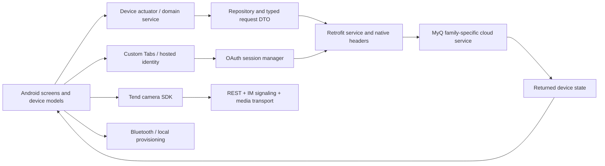

# Application architecture, packaging and platform behavior

This chapter documents MyQ Android **5.324.0.1132442**, package
`com.chamberlain.android.liftmaster.myq`. It describes the supplied artifact,
not every MyQ build or the currently deployed backend. Start at the
[reference index](../api/README.md) for authentication, device and video protocols.

## Artifact identity

| Property | Observed value |
| --- | --- |
| Supplied archive | `myQ+Garage+&+Access+Control_5.324.0.1132442_APKPure.xapk` |
| XAPK SHA-256 | `77aee562ebbef96712ac44b41ee899047f3a1e92860fe6e32d760e5422c7d7f5` |
| Base APK SHA-256 | `20d6e5d35a819169867f1b7ebbe13769720ae0b78cb6e26ef95bc9f36dabefb2` |
| Base APK size | 112,453,200 bytes |
| Version code | 1132442 |
| Minimum SDK | 31 |
| Target / compile SDK | 36 / 36 |
| Base DEX files | 9 |
| ZIP entries in the base APK | 6,344; the earlier inventory total of 6,345 includes the artifact root |
| Supplied APK members | Base APK, `config.arm64_v8a.apk`, `config.hdpi.apk` |
| Application class | `com.chamberlain.android.liftmaster.myq.MyQApplication` |
| Launcher activity | `com.chamberlain.myq.features.splashscreen.SplashActivity` |

The base manifest requires ABI and density splits. The base APK has no `lib/`
entries; the supplied ARM64 split contains 24 `.so` libraries. This is why a
base-only archive inventory does not establish absence of native code.

Earlier passes inventoried the supplied archive and base APK. This pass reused
those exact inventory records and added a target-free signing inspection.
Android SDK build-tools 36.0.0 `aapt2` independently decoded the compiled manifest
and XML resources. The [manifest inventory](app-manifest.json) records declarations,
source line numbers, component filters and permission limits. It omits metadata
values such as bundled API configuration keys.

## Signing observations

The signing inspection finds v2 and v3 records, one declared signer in each,
matching content digests, no declared rotation lineage and a source stamp. Both
schemes declare certificate SHA-256
`3c49834ec2790eb47233080401a5d37b354bd5ac639beeafbbef7c562005e40c`.
That inspection does **not** cryptographically verify signatures or establish
publisher trust; it reports four bytes outside known signing fields as a parser
coverage limitation, not as evidence of malformed signing.

A separate local `apksigner verify --verbose --print-certs` returned `Verifies`,
v3 verification true and source-stamp verification true. Its report marks v1,
v2, v3.1 and v4 verification false; this is recorded literally, rather than
equating a present v2 block with a separately verified v2 signature. The signer
certificate names Chamberlain/The Chamberlain Group and an RSA-2048 key.
The source-stamp certificate fingerprint is
`3257d599a49d2c961a471ca9843f59d341a405884583fc087df4237b733bbd6d`.
No independently trusted Play Store certificate comparison was performed.
Neither a certificate subject nor a source-stamp identity alone establishes
that comparison. The ABI/density split signatures were not separately verified.

## Runtime structure inferred from code

The retained Java export contains Kotlin metadata, coroutines, Android activities
and services, AndroidX/Compose classes, repository/service layers, Retrofit
interfaces and Tend/Seedonk SDK classes. This is an Android application with
multiple SDK and native boundaries. A packaged class or library establishes
presence, not that every feature executes for every account.

The traced control pattern is:



The action chain is demonstrated by `xy0/h.java`, family services such as
`a01/b.java`, `f11/a2.java`, `b01/a.java`, the action repository `zy0/a.java`,
and Retrofit declaration `bz0/e.java`. Production host composition uses public
environment configuration and service enums such as `oy0/b.java`.
Authentication, cloud authorization, camera signaling and device-local access
are separate layers; successful browser sign-in alone does not establish all of them.

`MyQApplication.java:onCreate` registers lifecycle/account observers, auth-related
callbacks, a live-stream indicator, deferred startup and telemetry-related setup.
Its readable method includes an early path that skips telemetry configuration
in a Phoenix process. This is static startup behavior, not a capture of emitted
telemetry or proof of which optional subsystem was enabled in a user session.

## Native library boundary

The ARM64 split contains these libraries:

```text
libDVL.so                       libQt5Core.so
libQt5Gui.so                    libQt5Widgets.so
libandroidx.graphics.path.so    libbarhopper_v3.so
libc++_shared.so                libdatastore_shared_counter.so
libface_detector_v2_jni.so      libgnustl_shared.so
libimage_processing_util_jni.so libjingle_peerconnection_so.so
libjnidispatch.so               libmediaWrapper.so
libnative-logger.so             libopus.so
libortp.so                      libqtforandroid.so
libseedonkp2pWrapper.so          libspeexdsp.so
libsqliteX.so                   libtoolChecker.so
libuniffi_dotlottie_player.so    libyuv.so
```

The readable Java camera code independently references native media/P2P and
WebRTC boundaries. Names such as Opus, oRTP, WebRTC and Seedonk are consistent
with those boundaries, but filenames alone do not establish codecs negotiated
at runtime or the behavior of `libtoolChecker.so`. No complete native
disassembly, JNI mapping or runtime instrumentation was performed. The KVS
path is explained in [video](../api/video.md); legacy native media remains partial.

## Manifest components, links and permissions

The decoded base manifest declares 84 activities, 25 services, 22 receivers and
8 providers. Twenty components explicitly declare `exported=true`; several are
library/system integration components, some with permission restrictions. These
counts do not establish external reachability, a vulnerability or successful
invocation. Component attributes and intent filters are preserved in the JSON inventory.

Relevant declared entry points include:

| Entry point | Declaration / significance |
| --- | --- |
| `SplashActivity` | Launcher entry |
| `DeeplinkTrampolineActivity` | HTTPS app-link filters and application navigation links |
| `MyQAuthActivity` | Browsable `com.myqops://android` OAuth callback |
| `WebViewFragmentActivity` | Includes `myq://hyundai-bluelink` filter |
| `MyQMessagingService` | Firebase message delivery integration |
| `CallConnectionService` | Android call integration for video calling |
| WorkManager and Firebase receivers/services | Background scheduling and message plumbing |

Declared HTTPS link domains include `www.myliftmaster.com`, regional/preview
domains and `myq.smart.link`. The trampoline's paths refer to invitations,
account validation, devices, live streams, guest management, schedules,
notifications, dealers, Amazon/Walmart delivery, subscriptions, face recognition,
detection zones and device provisioning. Path presence is a navigation inventory,
not proof that an unauthenticated caller can perform the corresponding action.
Do not combine every independent `<data>` item into a manually guessed URL;
the original filter grouping remains in `app-manifest.json`.

There are 38 requested-permission declarations and one app-defined permission.
Requested groups include network/Wi-Fi, Bluetooth scan/connect, location,
camera/microphone, notifications/vibration, foreground/phone-call integration,
biometrics, contacts/accounts, storage and advertising/attribution identifiers.
Specific older permissions have SDK limits: Bluetooth/administrator at 30,
read external storage at 32 and write external storage at 28. A declaration
does not mean a runtime permission was granted or that data was collected.

Optional hardware declarations include cameras, autofocus, camera flash,
front camera, telephony, landscape and Wi-Fi. BLE is required in the declared
feature list. `aapt2 badging` additionally reports implied features; the JSON
inventory preserves direct declarations separately from inferred requirements.

## Network security and local configuration

The manifest declares `usesCleartextTraffic=false` and references
`res/xml/network_security_config.xml`. The referenced XML declares:

| Scope | Configuration |
| --- | --- |
| Base configuration | `cleartextTrafficPermitted=true`; system trust anchors |
| Exact `api.prod.tendplatform.com` | Independent domain configuration using system anchors |
| `seedonk.com`, `isecurityplus.com`, `tendinsights.com`, `tendplatform.com`, including subdomains | One shared SHA-256 public-key pin set containing 39 pins; no expiration attribute |

For Android's configuration model, the XML matters: the manifest cleartext flag
is ignored on API 24+ when a network-security configuration exists. The longest
matching domain rule applies, and unset values inherit from the containing
configuration or base. Thus the exact calling-service rule must not be
conflated with the broad Tend pin group. This is a configuration interpretation,
not observation of traffic. [Android application attributes](https://developer.android.com/guide/topics/manifest/application-element#usesCleartextTraffic),
[network-security configuration](https://developer.android.com/privacy-and-security/security-config).

No identity-domain pin is declared in this XML. That does not prove absence of
pinning or additional checks in Java/native clients. No user-added CA anchor or
debug override is declared here. The iPhone's captured certificate rejection is
separate evidence from another platform and must not be attributed to this
Android XML. The local Wi-Fi provisioning interfaces described in the API chapter
also do not establish that cloud OAuth or media credentials travel over HTTP.

## Storage, background work and notification behavior

The manifest sets `allowBackup=false`, `requestLegacyExternalStorage=false` and
references both legacy backup and data-extraction rule files. The legacy rules
include shared preferences and exclude `wifi_credentials_shared_prefs.xml`.
The newer rules exclude the root from cloud backup and include shared
preferences for device transfer, again excluding that Wi-Fi credential file.
These are declarations; no device backup or transfer was executed and OS/OEM
effective behavior was not validated.

The export contains Room implementations for history/cache/filter preferences
and application diagnostics. For example, `LogsDatabase_Impl.java` declares
`log_table` with title/message/metadata/tags/category/level/timestamp columns;
`LiveDataDatabase_Impl.java` declares timestamped key/value entries. The history
cache declares story/device mapping and anomaly-response tables. No live app
database was acquired, and actual contents, retention, encryption and upload
behavior are not established by these table declarations.

`com/chamberlain/myq/features/notifications/azure/MyQMessagingService.java`
contains dispatch for camera motion/people/delivery events, face-recognition
events, assigned/unassigned remotes, doors, gates, lamps, locks, routine IDs and
dealer access. It builds Android notification channels and pending intents
that open app destinations. These observed handlers establish that push-based
notification paths exist; they do not establish a reusable Home Assistant push
subscription, message ordering or delivery guarantees.

The source also includes account, Android Auto/geofencing, Amazon delivery,
partners, provisioning, detection zones, face recognition, history, premium,
shopping, subscriptions, GDPR, telemetry and widget modules. API declarations
and several dispatch paths are cataloged, but complete UI/role/entitlement
behavior for these modules has not been reconstructed. Remote feature flags,
region and account state can change visible features without changing the APK.

## Evidence boundary

Manifest and resource observations were decoded locally with Android SDK tools.
The signing structure comes from the target-free signing inspection, with the
cryptographic check separately attributed to `apksigner`. Decompiled class
observations use the retained JADX 1.5.7 export, which contains 558
decompilation errors. This chapter neither claims exhaustive native analysis
nor reproduces a runtime session. Older 5.321 and installed 5.325 builds were not
compared with the selected artifact.
