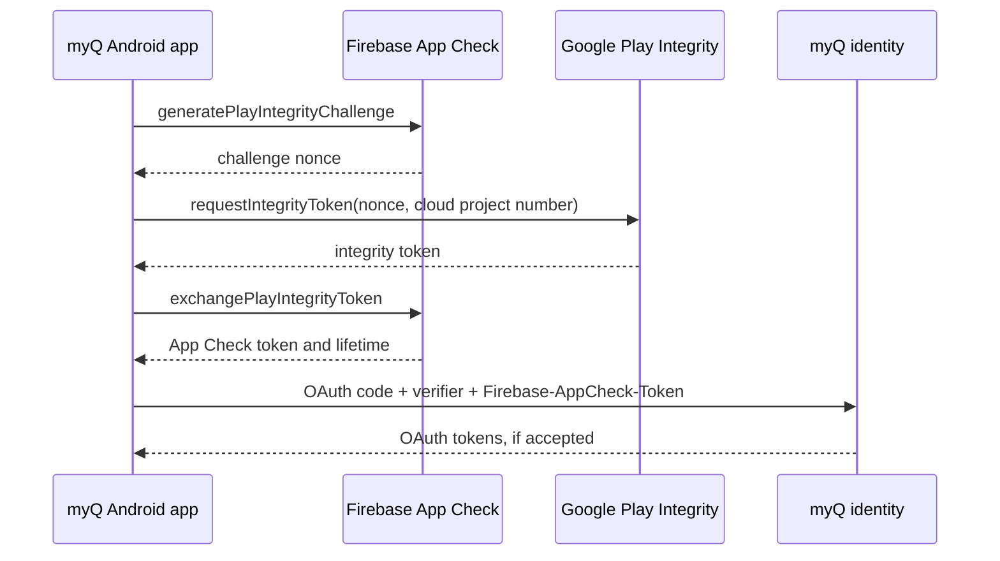

# Authentication review (November 20, 2026)

Implementation follow-up: the gaps below describe the pre-change code. The
provider lifecycle, native metadata, atomic exchange and HA browser handoff are
now implemented; see [browser-sign-in.md](../browser-sign-in.md). Generating native
proof and demonstrating a successful live login remain unresolved.

The app authenticates to `partner-identity.myq-cloud.com` (not
`partner-identify.myq-cloud.com`) using browser authorization-code OAuth with
S256 PKCE, followed by a native token exchange carrying Firebase App Check
proof obtained through Google Play Integrity. The repository implements the
OAuth request and exchange, but has no functioning App Check producer and does
not connect its browser-assisted development flow to Home Assistant setup.
Fresh inspection also found native request metadata missing from the Python
transport: `BrandId` and `App-Version`.

This review identifies implementation gaps; it does not establish a successful
MyQ API login. No credentials, authorization codes, or physical commands were
sent during this investigation. Runtime Python code was not changed.

**Evidence and limits**

The newer of the two supplied XAPKs was selected:
`myQ+Garage+&+Access+Control_5.324.0.1132442_APKPure.xapk`, package
`com.chamberlain.android.liftmaster.myq`. The older 5.321 package was not compared.

| Artifact | SHA-256 |
| --- | --- |
| Supplied XAPK | `77aee562ebbef96712ac44b41ee899047f3a1e92860fe6e32d760e5422c7d7f5` |
| Extracted base APK | `20d6e5d35a819169867f1b7ebbe13769720ae0b78cb6e26ef95bc9f36dabefb2` |
| Extracted `assets/myq-config.json` | `161b92ac474fae85a97bdb6ddbcdef2d2764243aefd6e2b4849fe5ac58efd202` |

Both containers were inventoried, and the APK and configuration were extracted
with verified hashes. Method analysis used the already-installed **JADX CLI
1.5.7** against the freshly extracted APK. That run exited with code 3 and
reported 558 errors across the application. Relevant readable methods were
inspected; their output is decompilation, not original source or runtime
observation. Some coroutine/control-flow output has warnings. The signing
certificate was not compared with a trusted Play Store copy.

The local evidence bundle and CLI provenance are retained in a private
checkpoint (not in the repository). The CLI source files are a local JADX 1.5.7
export, kept outside the repository; class references below are relative to the
export's sources directory. The provenance records hashes of the reviewed
classes.

**Observed authentication sequence**

1. The production configuration supplies the `.myq-cloud.com` suffix,
   `ANDROID_CGI_MYQ`, `MyQ_Residential offline_access`, and
   `com.myqops://android`. `hp0/e.java:86` builds the `partner-identity` host.
2. `sp0/b.java` opens Android Custom Tabs. Its call through `cp0/d.java` reaches
   `ip0/j.java:c()` and `ip0/n.java:h()`. For sign-in, `signUp=false`,
   `unifiedFlow=true`, and `isMFA=false`; `ap0/AuthUrlParams.java:60` selects
   `unified_flow:v1`.
3. `ip0/k.java:G()` builds `/connect/authorize` with those client/scope/redirect
   values, `response_type=code`, the S256 challenge, locale, `prompt=login`,
   and `acr_values=unified_flow:v1  brand:myq`. The hosted pages perform user
   login/MFA. Their successful behavior is historical capture evidence in
   [protocol evidence](protocol-evidence.md), not something observed by executing this APK.
4. On the custom-scheme callback, `sp0/b.java:b()` passes the attestation
   provider into the authentication manager. `ip0/n.java:r()` awaits that
   provider before calling the code-exchange service.
5. `ip0/k.java:E()` posts a form to `/connect/token` with `client_id`, `scope`,
   `grant_type=authorization_code`, `code`, `redirect_uri`, and
   `code_verifier`. `ip0/s.java:g()` adds the exact custom header
   `Firebase-AppCheck-Token`. This inspected request builder has no
   `client_secret` field.
6. Later refreshes use `client_id`, `grant_type=refresh_token`, and
   `refresh_token`, with `IsRefresh: true` (`ip0/s.java:i()`,
   `ft0/t0.java:b()`). This refresh path does not request an App Check token.
   Authenticated service calls use Bearer access tokens (`ft0/i0.java`).

The repository's extra OAuth `state` validation is worth retaining even though
the inspected Android authorization builder does not add it.

**How App Check is acquired**

`MyQToolsInitializer.java` injects `ml0/k.java`'s attestation provider.
`BackgroundDeferredInitializer.java:106` configures Firebase for production;
`hu/a.java:b()` registers `hr1/b.java`, the Play Integrity provider factory.

`ml0/f.java:a()` calls Firebase App Check with `forceRefresh=false`. The SDK
(`er1/j.java:p()`) considers its cached token reusable only when more than
300,000 milliseconds remain. If MyQ's callback receives an expired result,
`ml0/f.java` makes a forced-refresh request. MyQ's own release cache
(`ml0/l.java`, selected in `ml0/k.java:i()`) is a no-op; this does **not** mean
the Firebase SDK has no cache. The debug preferences named
`app_check_token_value` are not the release cache path.

When fresh proof is needed, `ir1/i.java` and `er1/o.java` describe this chain:

The Firebase requests use JSON and `X-Android-Package`, `X-Android-Cert`, plus
an optional `X-Firebase-Client` heartbeat header. These belong to the Firebase
exchange; they are not the headers the inspected MyQ token request uses.
The native provider sends the ordinary Play Integrity exchange path with
`limited_use` unset (`ir1/i.java:a()`, `ir1/a.java`). Server replay enforcement
was not observed.

Firebase documents registration against the app's signing certificate and
project. Its backend verification checks signature, issuer, expiry, and
audience, with optional app-ID restriction. Consequently, the APK's public
configuration alone does not supply the signed proof, and a token minted for
an unrelated Firebase project is not equivalent. MyQ's exact configured
verdict requirements and whether it accepts transferred proof remain unknown.
([Firebase Android setup](https://firebase.google.com/docs/app-check/android/play-integrity-provider),
[Firebase backend verification](https://firebase.google.com/docs/app-check/custom-resource-backend))

There are three distinct branches in `ip0/k.java:E()`:

| Provider result | Native request behavior | Interpretation |
| --- | --- | --- |
| Token acquired | Sends the acquired token | Normal configured path |
| Provider failed | Sends the literal `ERROR_RETRIEVING_TOKEN` | Failure marker; no evidence that the server accepts it |
| Provider unconfigured | Omits App Check header | SDK fallback; no evidence that the production service accepts it |

Integrity-specific failures subclass the generic failure (`dp0/d.java`), so
they also take the failure-marker path. `ip0/n.java:s()` maps a failed response
to the local diagnostic `401.122i` when it has that provider error.
`ip0/j.java` distinguishes this from the server code `401.122`. These branches
should not be treated as alternative ways to obtain a working token.

The suffix in the UI can narrow this classification. In the inspected 5.324
APK, `ml0/f.java` preserves `IntegrityServiceException.getErrorCode()`, but
assigns the app-defined value `-998` to an `xq1.m` exception from App Check.
`ft0/o0.java` carries that value in `401.122i`, and `hp0/c.java` renders it as
`401.122 (-998)`. The Firebase client can raise that exception for API errors,
unexpected responses, or throttling; the suffix alone does not establish the
failed Play Integrity verdict or an emulator-specific rejection.

**Additional native headers absent from the integration**

`y92/b.java:s()` supplies common request headers through the framework
configuration; `ft0/i0.java:129` adds them to requests, including OAuth.

| Header | Value in this app path | Python comparison |
| --- | --- | --- |
| `BrandId` | `1`, from `yk/a0.java` through `sa2/b.java` | Absent |
| `App-Version` | `5.324.0.1132442`, from `yk/b0.java` through `ta2/f.java` | Absent |
| `User-Agent` | Android device model + `/Android ` + OS version | `ha-myq/<version>`, or the selected curl browser profile |

The first two are additional protocol differences not previously described in
the authentication documentation. They are candidates for an explicit native
token-request profile and controlled validation. This static review does not
show that they are mandatory or that adding them resolves `401.122`. An Android
device model/OS must not be invented as an observed value. Browser navigation
and native token exchange should have separately scoped transport settings.

**Prioritized enhancements**

| Priority | Location | Gap and concrete next step |
| --- | --- | --- |
| P0 | [tokens.py](../../custom_components/myq/api/tokens.py), `exchange_code()` | Accepts an opaque supplied token but has no producer. Establish a genuine MyQ-compatible proof source and validate one fresh exchange before investing in automated acquisition. A separately signed helper is not established as an accepted MyQ app. Existing refresh-token import is another already-implemented route if a valid authorized session is available. |
| P0 | [config_flow.py](../../custom_components/myq/config_flow.py), `async_step_login()`; [auth.py](../../custom_components/myq/api/auth.py), `_navigate()` | HA constructs the raw HTTP `Login` and completes OAuth without App Check. Provide a supported browser/helper handoff to HA and connect proof acquisition to completion. Preserve PKCE/state ownership and same-account validation. The registered custom URI cannot simply be replaced with an arbitrary HA callback. |
| P1 | [http.py](../../custom_components/myq/api/http.py), [curl_http.py](../../custom_components/myq/api/curl_http.py), [tokens.py](../../custom_components/myq/api/tokens.py) | Model the observed `BrandId`/`App-Version` metadata for native requests and test their placement. Keep the app version tied to analyzed protocol provenance; these headers are not substitutes for App Check. Their server-side effect still needs validation. |
| P1 | [probe_account.py](../../scripts/probe_account.py), lines 104–152 | Currently prompts for proof before a browser flow that may take ten minutes. Introduce an asynchronous provider returning proof plus expiry; obtain or revalidate it immediately before exchange, with bounded waits, freshness margin, cancellation, and concurrent acquisition control. Do not log proof or fold it into persisted OAuth credentials. |
| P1 | [oauth.py](../../custom_components/myq/api/oauth.py), `complete()` | Marks the transaction used before `exchange_code()` validates the supplied header. Prepare and validate proof first, then re-check transaction expiry and atomically claim the exchange after any awaited acquisition. Retain one-shot behavior once a network exchange starts, including uncertain failures. |
| P1 | [errors.py](../../custom_components/myq/api/errors.py), diagnostics and HA setup | Keep unavailable proof, local integrity failure, server `401.122`, invalid OAuth grant, and browser verification distinct. The current server `401.122` classification is already present. Add lifecycle diagnostics only when the corresponding provider exists; retain fixed categories and exclude raw provider exceptions/tokens. |

A suitable design boundary would be an injected `AppCheckProvider.acquire()`
returning a token and expiry, used by both the development probe and HA's
sign-in completion path. That interface alone would not solve acquisition.
The current research does not justify an unconditional fabricated proof,
automatic failure-marker fallback, or repeated password/MFA attempts.

Already implemented and consistent with the inspected paths: Android OAuth
constants, S256 PKCE, unified sign-in parameters, form-encoded code exchange,
optional App Check header, refresh grant and `IsRefresh`, serialized refresh
rotation, token persistence callbacks, and state/expiry/one-shot checks. The
browser/HAR helper already validates callbacks, but remains development-only.

**Validation and remaining unknowns**

Fresh offline check: **61 tests passed** across `test_oauth.py`,
`test_token_exchange.py`, `test_auth.py`, `test_har.py`, and
`test_captured_login.py`. These are synthetic/mocked tests, not evidence of
server acceptance. No runtime implementation changes were made.

The earlier real callback's exchange returned HTTP 401, but its original body
was not retained. Separate deliberately invalid-code diagnostics returned
`401.122`. Missing App Check is therefore a confirmed implementation mismatch
and a plausible blocker, **not a proven sole explanation of that real-code
failure**. The missing native metadata is an additional variable.

The next decisive validation is a fresh matching code/verifier and a current,
genuine MyQ-compatible proof, with observed native metadata, followed by
read-only profile/device discovery and refresh/restart checks. A successful
login with multiple corrected inputs would demonstrate that combination;
it would not isolate which field the server required. No such proof or
successful API session was available in this review.

Checklist outcome: artifact identity answered; static authentication and
provider chain answered within decompilation limits; repository gaps answered;
current server enforcement, accepted proof source, and end-to-end operation
remain unresolved.
